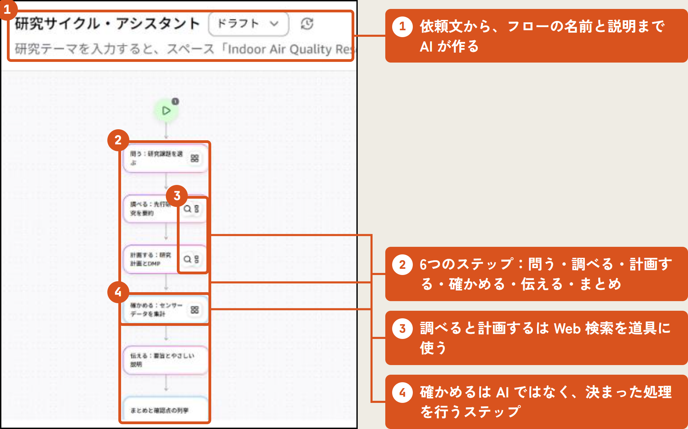
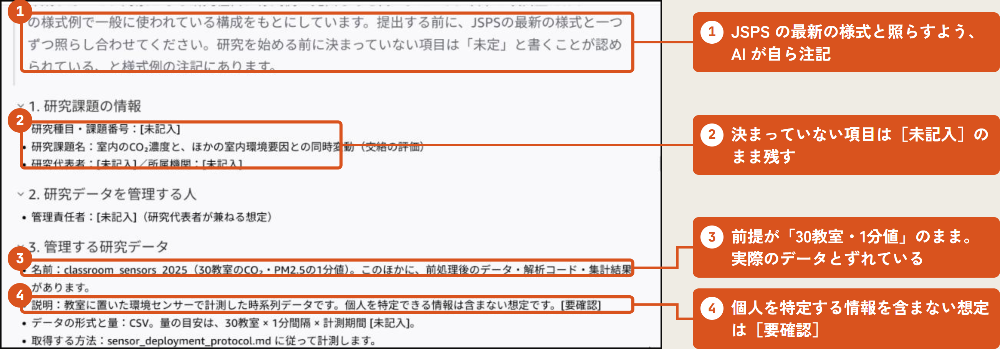
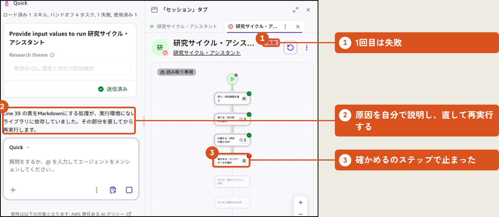
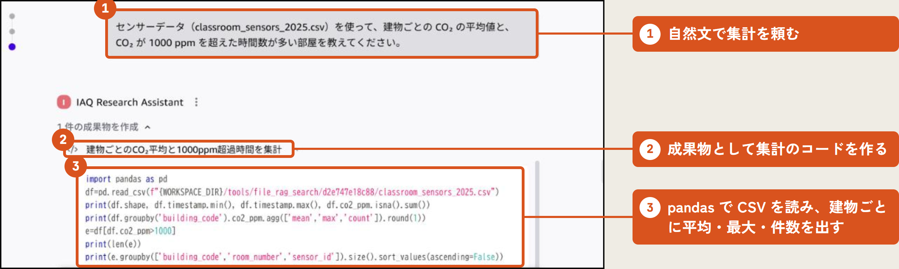

<!-- _class: cover -->
<!-- _header: '' -->
<!-- _paginate: false -->

# 研究サイクルを AI で一周させる

AWS 公式ハンズオン「Amazon Quick for Research」の応用発表者名

<!--
【ノート】20秒。
こんにちは。今日は、研究のサイクル、つまり問いを立てて、調べて、計画して、確かめて、伝える、という一連の流れを、AWS の AI サービスで一周させてみた話をします。
題材にしたのは、AWS が公開している研究者向けの公式ハンズオンです。まず、今日の題材を紹介します。
-->

---

00

題材

## 今日の題材

業務向けの AI サービス <em>AWS Quick</em> と、AWS 公式の研究者向けハンズオンを使い、研究サイクル全体への応用を試した。

2.5<small>時間</small>

公式ハンズオンの所要時間 大学の研究スタッフ向け

5<small>段</small>

AI で回した研究の段 問う から 伝える まで

3<small>分</small>30<small>秒</small>

研究サイクルを 一周させた時間

0<small>円</small>

今回かかった費用 無料トライアルで実施

AWS Quick は 2026 年 11 月 9 日に Amazon Quick から改称された。ハンズオンの名前は改称前のまま

出典：<a href="https://catalog.us-east-1.prod.workshops.aws/workshops/ca04310e-b365-49f4-830b-a02bb06658e9/en-US">Amazon Quick for Research｜AWS Workshop Studio</a>・<a href="https://aws.amazon.com/about-aws/whats-new/2026/11/amazon-quick-aws-quick/">Amazon Quick is now AWS Quick｜AWS What's New</a>

<!--
【ノート】45秒。
題材は 2 つです。1 つは AWS Quick。業務の調査や分析、自動化を AI エージェントにやってもらうサービスで、つい先日、11 月 9 日に Amazon Quick から AWS Quick に名前が変わりました。
もう 1 つは、AWS 公式のハンズオン「Amazon Quick for Research」です。大学の研究アシスタントや研究スタッフ向けで、所要時間は 2.5 時間ほどです。
私はこのハンズオンを一通りやったうえで、その仕組みを研究のサイクル全体に広げ、問う・調べる・計画する・確かめる・伝えるの 5 つの段を、1 本の流れとして AI に回させてみました。一周は 3 分 30 秒、費用は無料トライアルの範囲でゼロでした。
今日はこの順番で話します。
-->

---

<!-- _header: '' -->

### Tracklist

01研究における AI 活用の背景

02研究サイクルと AI の役割分担

03AI で研究サイクルを一周

04AWS Quick を支える仕組み

05文教ビジネスへの示唆

<!--
【ノート】20秒。
まず、なぜいま研究に AI なのかという背景。次に、研究のサイクルのどこを AI に任せられるかという枠組み。そのうえで、実際に一周させた実践、それを支える AWS の仕組み、最後に文教ビジネスへの示唆です。
（配分：表紙・題材・目次で約 1 分半、TRACK 01 が約 3 分半、02 が約 3 分、03 が約 8 分、04 が約 8 分、05 が約 2 分半。合計は約 26 分。持ち時間が短いときは 04 を「3 層」「構成」「統制」の 3 枚に、03 を「問う」「計画する」「一周して分かったこと」に絞る）
では背景からです。
-->

---

<!-- _class: t1 dark eye -->

01

### Background

研究における AI 活用の背景

<!--
【ノート】10秒。
最初のトラックは、研究における AI 活用の背景です。研究の現場がいま何に時間を取られているのかを、国のデータで見ていきます。
-->

---

<!-- _class: t1 dense -->

01

研究時間

## 研究時間の減少

大学教員が研究に使う時間の割合は、約 20 年で <em>46.5% から 32.2%</em> に下がり、教育の時間が増えた。

大学教員の職務時間の割合・2002 年度と 2023 年度

研究 200246.5%

研究 202332.2%

教育 200223.7%

教育 202330.4%

学内事務 200219.9%

学内事務 202319.7%

出典：<a href="https://www.mext.go.jp/content/20250418-mxt_chousei01-000040124.pdf">文部科学省「令和5年度 大学等におけるフルタイム換算データに関する調査」概要</a>・<a href="https://www.mext.go.jp/content/20250116-mxt_chousei01-000046785_1.pdf">同 結果の再公表</a>

<!--
【ノート】50秒。
文部科学省は 5 年ごとに、大学の教員が勤務時間をどう使っているかを調べています。
2002 年度、研究に使う時間は 46.5% でした。2023 年度は 32.2% です。約 20 年で 3 分の 2 ほどに減っています。代わりに増えたのが教育で、23.7% から 30.4% になりました。学内事務はおよそ 2 割のまま、横ばいです。
同じ調査では、研究時間の制約として、教授会などの学内会議を含む大学運営業務を挙げる教員が最も多くなっています。
では、研究そのものに付いて回る仕事はどうでしょうか。
-->

---

<!-- _class: t1 dense -->

01

研究を回す仕事

## 研究を回す仕事の増加

研究費を受けると、データの管理計画や論文の即時公開といった<em>研究を回す仕事</em>が、制度として求められるようになった。

| 制度 | 対象と時期 | 研究者に求められること |
|---|---|---|
| データマネジメントプラン | 公募型の研究資金で 2023 年度までに導入率 100% が目標・科研費は 2024 年度以降の全課題 | 研究の開始時に管理計画を立て、公開したデータの情報を報告する |
| 即時オープンアクセス | 2025 年度から新たに公募する科研費などの競争的研究費 | 論文と根拠データを、雑誌への掲載後すぐに機関リポジトリなどで公開する |
| 研究費の申請と報告 | 2018〜2022 年度の 5 年間の平均 | 申請 4.5 件で計 99 時間、報告 2.5 件で計 37 時間 |

出典：<a href="https://www8.cao.go.jp/cstp/kihonkeikaku/6honbun.pdf">第6期科学技術・イノベーション基本計画</a>・<a href="https://www.jsps.go.jp/j-grantsinaid/01_seido/10_datamanagement/index.html">日本学術振興会 科研費における研究データの管理・利活用</a>・<a href="https://www8.cao.go.jp/cstp/oa_240216.pdf">学術論文等の即時オープンアクセスの実現に向けた基本方針</a>・<a href="https://www.mext.go.jp/content/20250418-mxt_chousei01-000040124.pdf">文部科学省 FTE 調査 概要</a>

<!--
【ノート】60秒。
研究時間が減る一方で、研究そのものに付いて回る仕事は、制度として増えています。
1 つ目はデータマネジメントプラン、DMP です。国の基本計画は、公募型の研究資金で 2023 年度までに DMP の導入率を 100% にする目標を掲げました。科研費では 2024 年度以降、新規も継続もすべての課題で、研究の開始時に管理計画を立て、公開したデータの情報を報告することになっています。
2 つ目は即時オープンアクセスです。2025 年度から新たに公募する科研費などでは、論文と根拠データを、雑誌に載ったらすぐに機関リポジトリなどで公開することが義務になりました。
3 つ目は、もともとある申請と報告です。同じ調査では、5 年間で申請に計 99 時間、報告に計 37 時間かかっています。
研究者の時間が減り、回す仕事は増えている。では、国はどこに向かおうとしているのでしょうか。
-->

---

<!-- _class: t1 dense -->

01

国の方向性

## 国の方向性

文部科学省は、AI で研究プロセスを自動化し、<em>研究者が創造的な活動に専念できる環境</em>を目指す方針を決めた。

「研究プロセスの自動化・知能化により知の生産性を向上させ、研究者がより高次元で創造的な活動に専念できる環境を実現する」── 文部科学省「AI for Science の推進に向けた基本的な戦略方針」政策目的Ⅰ・2026 年 3 月 31 日

5<small>年</small>

2026〜2030 年度の集中改革期間 研究力・計算資源・データの 3 本柱

15,868<small>件</small>

AI 研究の公募 SPReAD への応募 採択は 456 件・採択率 2.9%

31<small>件</small>

フラグシップ事業 ARiSE の採択 2026 年 9 月に発表

出典：<a href="https://www.mext.go.jp/content/20260403-mxt_jyohoka01-000048752_1.pdf">AI for Science の推進に向けた基本的な戦略方針</a>・<a href="https://www.mext.go.jp/content/20260629-mxt_jyohoka01-000050750_1.pdf">AI for Science 推進委員会 第5回 資料1</a>・<a href="https://www.jst.go.jp/pr/info/info1875/index.html">JST ARiSE 新規採択</a>

<!--
【ノート】55秒。
文部科学省は今年 3 月、「AI for Science の推進に向けた基本的な戦略方針」を決めました。AI は仮説の生成、実験の設計、解析、知識の統合といった研究プロセスのあらゆる段階に関わり始めている、という認識です。
政策の目的の 1 つ目に、こう書いてあります。「研究プロセスの自動化・知能化により知の生産性を向上させ、研究者がより高次元で創造的な活動に専念できる環境を実現する」。
2026 年度から 2030 年度を集中改革期間とし、AI を使った研究を支える公募 SPReAD には 1 万 5 千件を超える応募があって、採択率は 2.9% でした。研究者の関心の高さが分かります。
ここまでをまとめます。
-->

---

<!-- _class: t1 -->

01

背景

研究の時間を、 研究に戻す。

| 観点 | 現状 |
|---|---|
| 研究者の時間 | 研究に使える割合は 46.5% から 32.2% に減った |
| 研究を取り巻く要請 | データの管理計画や論文の即時公開が、制度として求められる |
| 国の方向性 | AI で研究プロセスを自動化し、研究者を創造的な活動に戻す |

<!--
【ノート】30秒。
背景をひと言でいうと、「研究の時間を、研究に戻す」です。研究者の時間は減り、研究を回す仕事は制度として増え、国は AI で研究プロセスを自動化する方向に舵を切りました。
では、研究のどこを AI に任せられるのか。次のトラックで、研究のサイクルという枠組みで整理します。
-->

---

<!-- _class: t2 dark eye -->

02

### Framework

研究サイクルと AI の役割分担

<!--
【ノート】10秒。
2 つ目のトラックは、研究サイクルと AI の役割分担です。具体的な操作の前に、全体の地図を描きます。
-->

---

<!-- _class: t2 dense -->

02

研究サイクル

## 研究のサイクル

研究は「問う・調べる・計画する・確かめる・伝える」の繰り返しで、各段に<em>研究を回す仕事</em>が付いて回る。

<!--
【ノート】50秒。
研究は、大きく 5 つの段の繰り返しです。研究の問いを立てる、先行研究を調べて空白を見つける、仮説と方法を計画する、データで確かめる、そして成果を伝える。伝えた成果から次の問いが生まれます。
上の段が研究の知的な作業だとすると、下の段は、それぞれに付いて回る「研究を回す仕事」です。資料の引き継ぎ、文献の管理、研究費の申請やデータ管理計画、データの保存、論文の公開と報告。オレンジの枠は、さっき見た制度の要請です。
研究者の時間を奪っているのは、主にこの下の段です。では、この中で何を AI に任せ、何を人が持つべきでしょうか。
-->

---

<!-- _class: t2 dense -->

02

役割分担

## 人と AI の分担

AI は<em>探す・整理する・下書きする・計算する</em>を担い、人は問いを選び、判断し、責任を持つ。

| 段 | AI に任せる | 人が決める |
|---|---|---|
| 問う | 資料と文献から問いの候補を出す | どの問いに取り組むか |
| 調べる | 先行研究を集めて出典つきで要約する | 引用が正しいか |
| 計画する | 研究計画と DMP の下書きを作る | 方法・公開範囲・倫理の判断 |
| 確かめる | コードを書いてデータを集計する | 結果の解釈と検算 |
| 伝える | 読み手に合わせて書き分ける | 何を主張するか |

科研費の公募要領は、研究計画調書の作成に生成 AI を使うかを「研究者個人の責任において判断」するよう求めている

出典：<a href="https://www.jsps.go.jp/file/storage/kaken_kiban_2026_g_4978/r9_7_kobo.pdf">令和9年度 科学研究費助成事業 公募要領</a>

<!--
【ノート】55秒。
分担の考え方はシンプルです。AI には、探す、整理する、下書きする、計算するを任せます。人は、どの問いに取り組むかを選び、結果を判断し、責任を持ちます。
問うなら、AI が候補を出し、人が選ぶ。調べるなら、AI が要約し、人が引用の正しさを見る。計画するなら、AI が下書きし、データをどこまで公開するか、倫理的に問題がないかは人が決める。確かめるなら、AI が集計し、人が解釈と検算をする。伝えるなら、AI が書き分け、何を主張するかは人が決める。
実際、科研費の公募要領も、研究計画調書に生成 AI を使うかどうかは研究者個人の責任で判断するよう求めています。
この分担を、AWS Quick の機能に当てはめるとこうなります。
-->

---

<!-- _class: t2 dense -->

02

AI の配置

## AI の配置

研究室の資料を Space に保存し、各段に AWS Quick の機能を割り当て、<em>Flows で一周をつなぐ</em>。

<!--
【ノート】50秒。
土台は Space です。研究室の資料を 1 か所にまとめて、AI が検索できるようにします。
問う・計画する・伝えるは、チャットエージェントが資料を読んで、候補や下書きや説明文を作ります。調べるは Research という機能で、Web と研究室の資料を調べて出典つきでまとめます。確かめるは、AI が Python のコードを書いて実行します。
そして一番下の Flows が、この 5 つの段を 1 本の流れにつなぎます。テーマを入れるだけで、問うから伝えるまでを一周させられる、という設計です。
では、実際に一周させてみます。
-->

---

<!-- _class: t3 dark eye -->

03

### Practice

AI で研究サイクルを一周

<!--
【ノート】10秒。
3 つ目のトラックは実践です。研究サイクルを、AI で実際に一周させました。
-->

---

<!-- _class: t3 dense -->

03

ハンズオン

## 公式ハンズオンで確かめた基本

公式ハンズオンでは、4 つの機能が<em>研究室の資料に基づいて</em>回答・集計・自動化できることを確かめた。

| 機能 | 確かめたこと |
|---|---|
| チャットエージェント | 汎用の AI は一般論で回答したが、研究室の手順書の節を示して回答した。資料に無い p 値は「情報がない」と回答した |
| Research | 5 つの調査を並行して進め、日本の学校の CO₂ 基準と各国の値を比べる図まで作成した |
| コード実行 | センサーデータの集計が、発表者の手元での検算と一致した |
| Flows | 研究費の見積もりのフローを作成すると、前提の置き方で月 3.32 USD にも 206.33 USD にもなった |

題材は、教育施設の室内の空気を研究する研究室。資料は手順書・文献レビュー・基準の要約・3 棟 9 台のセンサーの 1 か月分のデータ

<!--
【ノート】55秒。
まず公式ハンズオンを一通りやって、基本を確かめました。題材は、学校や大学の建物の室内の空気、特に教室の CO₂ を研究している研究室です。
チャットエージェントに研究室の手順書を渡すと、汎用の AI が一般論で答えた質問に、手順書の何節にこう書いてある、と答えました。資料に無い数値を聞くと、推測せずに「情報がない」と言います。
Research は 5 つの調査を並行して進めて報告書を書き、日本の学校の CO₂ 基準と海外の基準を比べる図まで描きました。コード実行による集計は、私の手元の検算と一致しました。Flows で研究費の見積もりを作ると、前提の置き方次第で月 3 ドルにも 206 ドルにもなりました。
この基本を、研究サイクル全体に広げます。
-->

---

<!-- _class: t3 dense -->

03

準備

## 一周させる準備

5 つの段を担う<em>フロー「研究サイクル・アシスタント」</em>を、依頼文 1 つから AI に組ませた。

<!--
【ノート】45秒。
研究室の資料 5 つを Space に入れたうえで、Flows に日本語でこう頼みました。「研究テーマを入れると、問う、調べる、計画する、確かめる、伝えるの 5 段で研究サイクルを一周させるフローを作って。計画では日本学術振興会の DMP の項目に沿った下書きも作り、最後に人が確認すべき点を並べて」。
すると 1 分ほどで、6 つのステップのフローが出来上がりました。調べると計画するは Web 検索を道具に使います。確かめるのステップだけは AI ではなく、決まった集計の処理として作られています。
研究テーマには「教室の CO₂ 濃度と学生の認知機能」を入れて実行しました。最初の段、問うから見ていきます。
-->

---

<!-- _class: t3 dense -->

03

問う

## 問う

研究サイクル：問う調べる計画する確かめる伝える

資料と文献の空白から研究課題の候補を 3 つ挙げ、<em>新規性と実現可能性で採点</em>して 1 つを選んだ。

| 研究課題の候補 | 新規性 | 実現可能性 | AI の判断 |
|---|---|---|---|
| 教室で 1000ppm を超える長さと時間帯を、建物の用途ごとに調べる | 2 | 5 | 実態調査にとどまる |
| CO₂ が高い時間帯に、PM2.5 や温度も一緒に上がるかを調べる | 4 | 4 | 採用・合計が最も高い |
| CO₂ にさらされた時間の累積が、試験の成績を下げるかを調べる | 5 | 2 | 認知のデータが無い |

<!--
【ノート】50秒。
問うの段では、AI が研究室の文献レビューと手元のデータを見比べて、まだ分かっていないことから研究課題の候補を 3 つ出しました。そして新規性と実現可能性を 5 段階で採点しています。
1 つ目は実態調査で、すぐできるけれど新しさは低い。3 つ目は一番新しいけれど、認知機能のデータが手元に無いので今は検証できない。そこで 2 つ目、CO₂ が高い時間帯に、PM2.5 や温度、湿度も一緒に上がっているかを調べる課題を選びました。もし一緒に上がっているなら、これまで「CO₂ の影響」とされてきた認知の低下に、ほかの要因が混ざっている可能性がある、という問いです。
人が見るべきは、この選び方に納得できるかどうかです。次は調べるです。
-->

---

<!-- _class: t3 dense -->

03

調べる

## 調べる

研究サイクル：問う調べる計画する確かめる伝える

先行研究を Web と研究室の資料から要約し、<em>研究室の資料の引用のうち確かめられないもの</em>を指摘した。

| 研究室の資料の記述 | AI が Web で確かめた結果 |
|---|---|
| Du et al. 2020 はメタ分析で、1000ppm 超で有意な低下 | 見つかった論文は「結果は一貫しない」とするレビューだった |
| Zhang et al. 2022 は教室で成績が 12% 高い | 論文の存在を確認できなかった |
| ASHRAE の基準は屋外より何 ppm 高いか | 資料によって 1000ppm と 700ppm の 2 通りがある |

研究室の資料はハンズオン用のサンプル。表は AI の指摘で、発表者は論文を確かめていない

<!--
【ノート】50秒。
調べるの段では、選んだ課題の先行研究を、Web と研究室の資料から集めて要約しました。主張ごとに出典を付けるよう指示しています。
面白かったのは、研究室の資料そのものへの指摘です。文献レビューでメタ分析とされていた論文は、Web で見つかったものは「結果は一貫しない」とするレビューでした。教室で成績が 12% 高かったという論文は、存在を確認できなかったそうです。
実はこの文献レビューはハンズオン用のサンプルなので、架空の引用が混ざっていても不思議ではありません。ただ、研究室に引き継がれてきた資料をそのまま信じず、照らし合わせて疑ってくれるのは、調べる段の AI の大きな価値です。
次は計画するです。
-->

---

<!-- _class: t3 dense -->

03

計画する

## 計画する

研究サイクル：問う調べる計画する確かめる伝える

仮説 5 つの研究計画と DMP の下書きを作成し、<em>人が決める箇所に印</em>を付けたが、前提の一部がデータとずれていた。

<!--
【ノート】55秒。
計画するの段では、仮説を 5 つ立てた研究計画と、日本学術振興会の DMP の項目に沿った下書きを作りました。
良かったのは、決まっていないことを勝手に埋めないことです。研究課題の番号や代表者は未記入のまま。データの保存期間は「研究が終わってから 10 年以上、ただし機関の規程を要確認」、生データを公開するかは「学校の同意次第で要判断」と、人が決めるべき箇所に印を付けています。
一方で、データを「30 教室・1 分値」と書いています。実際のデータは 9 か所の 1 時間ごとの値です。計画のステップがデータを読めず、依頼文の前提のまま書いてしまったためで、この食い違いは後で AI 自身も指摘しました。
次は確かめるです。
-->

---

<!-- _class: t3 dense -->

03

確かめる

## 確かめる

研究サイクル：問う調べる計画する確かめる伝える

センサーデータ 6,480 行をコードで集計した結果は、<em>手元の検算とすべて一致</em>した。

552<small>ppm</small>

1 月の CO₂ の平均 最大は 1,205ppm

0.5<small>%</small>

1000ppm を超えた時間の割合 ほぼ実験室 Lab1 に集中

660<small>前後</small>

8〜18 時の平均 ppm 夜はおよそ 460

0.41

CO₂ と PM2.5 の相関係数 仮説の基準 0.3 以上

発表者が Python で同じ CSV を集計：平均 551.7・最大 1205・超過 0.46%・Lab1 は 3.75%・昼 653〜675・夜 459〜462・相関 0.406

<!--
【ノート】50秒。
確かめるの段では、センサーデータ 6,480 行をコードで集計しました。CO₂ の平均は 552ppm、最大は 1,205ppm。1000ppm を超えたのは全体の 0.5% で、ほとんどが実験室でした。授業のある 8 時から 18 時は 660ppm 前後、夜は 460 前後で、人がいると上がることがはっきり出ています。
仮説に関わる CO₂ と PM2.5 の相関は 0.41 で、仮説の基準の 0.3 を超えました。
私も手元で同じ集計をしましたが、すべて一致しました。しかも AI は「相関の種類と信頼区間はまだ確認していない」と、自分で限界を書いていました。
最後の段、伝えるです。
-->

---

<!-- _class: t3 dense -->

03

伝える

## 伝える

研究サイクル：問う調べる計画する確かめる伝える

同じ結果から、研究室向けの要旨と<em>学校の先生向けのやさしい説明</em>を書き分けた。

<!--
【ノート】45秒。
伝えるの段では、同じ結果から 2 種類の文章を書きました。
1 つは研究室の週例ミーティング用の要旨で、背景・課題・方法・暫定結果・次の一手の順にまとまっています。
もう 1 つは学校の先生向けの説明です。PM2.5 を「細かいちり」と言い換え、「CO₂ が多いときは PM2.5 も一緒に増える傾向があるが、一緒に動いているというだけで、どちらが原因かはまだ分からない」と、言い過ぎないように書いていました。教室でできる換気の工夫も添えています。
研究の成果を学校の現場に返すところまで、一つの流れで書けるのは文教の立場からも面白いところです。
では、一周してみて何が分かったかです。まず、1 回目の失敗からです。
-->

---

<!-- _class: t3 dense -->

03

一周の結果

## 失敗からの立て直し

1 回目は集計のステップで止まったが、Quick は<em>原因を説明し、自分で修正して</em>再実行した。

<!--
【ノート】35秒。
実は 1 回目の実行は、確かめるのステップで止まりました。集計結果を表にする処理が、実行環境に入っていないライブラリを使っていたからです。
Quick は「この処理が実行環境にないライブラリに依存していました。直してから再実行します」と原因を説明し、フローを自分で書き換えました。2 回目は 3 分 30 秒で最後まで通りました。
では、一周して分かったことをまとめます。
-->

---

<!-- _class: t3 dense -->

03

一周の結果

## 一周して分かったこと

一周は 3 分 30 秒で回り、AI は自分で 37 の確認点を挙げたが、<em>前提のずれは人が修正する</em>必要があった。

| 分かったこと | 具体的には |
|---|---|
| 速く一周する | テーマ 1 つから、問いの候補・要約・計画と DMP・集計・2 種類の文章までが 3 分 30 秒で生成された |
| 自分で点検する | 人が確認すべき点を 37 項目挙げ、フローの修正方法まで提案した |
| 前提がずれる | 計画のステップがデータを読めず、計画の前提が実際のデータと食い違った |
| 資料を疑える | 研究室の資料の引用のうち、確かめられないものを指摘した |

<!--
【ノート】50秒。
一周してみて分かったことは 4 つです。
1 つ目、速い。テーマを 1 つ入れるだけで、問いの候補から文章まで 3 分 30 秒で出てきます。
2 つ目、自分で点検する。人が確認すべき点を 37 項目挙げ、計画のステップがデータを読めていないから直そう、とフローの改善まで提案してきました。
3 つ目、ただし前提はずれる。計画の段がデータを読めず、実際と違う前提で書いていました。ここは人が気づいて直す必要があります。
4 つ目、資料を疑える。研究室で引き継がれてきた資料の引用を、Web で照らして疑ってくれます。
まとめると、こうです。
-->

---

<!-- _class: t3 -->

03

実践

AI は一周を速く回し、 人は前提を正す。

| 段 | AI が行ったこと | 人が判断すること |
|---|---|---|
| 問う・調べる | 候補を採点し、資料の引用を疑った | 課題の選び方と引用の正しさ |
| 計画する | 計画と DMP を下書きし、決める箇所に印を付けた | 前提のずれと、印を付けた箇所 |
| 確かめる・伝える | 集計し、読み手ごとに書き分けた | 検算と、言い過ぎがないか |

<!--
【ノート】30秒。
実践のまとめは「AI は一周を速く回し、人は前提を正す」です。
AI は候補を採点し、下書きし、集計し、書き分けました。人がするのは、選び方に納得すること、前提のずれに気づくこと、検算すること、そして言い過ぎていないかを見ることでした。
では、これを AWS はどういう仕組みで実現しているのか。4 つ目のトラックです。
-->

---

<!-- _class: t4 dark eye -->

04

### Architecture

AWS Quick を支える仕組み

<!--
【ノート】10秒。
4 つ目のトラックは、AWS Quick を支える仕組みです。AWS の AI サービス全体の中での位置付けから入ります。
-->

---

<!-- _class: t4 dense -->

04

全体像

## AWS の生成 AI の 3 層

AWS の生成 AI は「すぐ使う・エージェントを作る・モデルを作る」の 3 層で、AWS Quick は<em>最上段のすぐ使える AI</em> にあたる。

出典：<a href="https://docs.aws.amazon.com/decision-guides/latest/decision-guides/genai-guide.html">Choosing a generative AI service｜AWS Decision Guide</a>・<a href="https://aws.amazon.com/jp/blogs/news/aws-jpps-seminar-2026-april/">AWS 公共セミナー 2026 開催報告</a>

<!--
【ノート】55秒。
AWS は生成 AI のサービスを 3 つの層で説明しています。
一番下は、AI のモデルそのものを作りたい人向けで、SageMaker AI や、学習用のチップ Trainium などです。
真ん中は、AI エージェントを自分で作りたい人向けです。いろいろな基盤モデルを API で使える Amazon Bedrock、作ったエージェントを安全に動かす AgentCore などがここにあります。
一番上が、モデルを選ばずにすぐ使える AI エージェントです。開発向けの Kiro、コンタクトセンターの Connect と並んで、AWS Quick がここに入ります。
つまり Quick は、自分でエージェントを作らなくても、業務の担当者がブラウザからすぐに使える層の製品です。その中身を見ていきます。
-->

---

<!-- _class: t4 dense -->

04

構成要素

## AWS Quick の構成

Space の資料を 3 つの機能が道具を使って処理し、組織向けのプランでは<em>自分の AWS アカウントのデータ</em>にも接続する。

出典：<a href="https://docs.aws.amazon.com/quick/latest/userguide/what-is.html">What is AWS Quick｜AWS Quick ユーザーガイド</a>

<!--
【ノート】60秒。
AWS Quick の中を図にしました。研究者はブラウザから使います。
土台は Space で、資料をアップロードすると AI が検索できる状態になります。その上で、チャットエージェント、Research、Flows の 3 つの機能が動き、必要に応じて、ファイル内の検索、Web 検索、コード実行といった道具を使い分けます。
外とのつなぎ先もあります。S3 や Google Drive などの資料をナレッジベースとして取り込んだり、MCP や OpenAPI という形式で外部の API をコネクタとして呼んだりできます。
右側は、公式ハンズオンの手順で自分の AWS アカウントに作るものです。データを置く S3、表の定義の Glue、SQL で集計する Athena と、AI から呼ぶ API。ただしこの AWS 側につなぐのは組織向けのプランの機能で、今回の無料の Plus ではつないでいません。
次に、エージェントが 1 回の質問で何をしているかを見ます。
-->

---

<!-- _class: t4 dense -->

04

エージェント

## エージェントの 1 回の処理

日本語の検索語では 0 件で、<em>英語に言い換えた検索語</em>で手順書が見つかり、それを出典に回答した。

<!--
【ノート】45秒。
公式ハンズオンで、専門家エージェントにサンプリング間隔を聞いたときの、裏側の動きです。
入力は日本語の質問と、エージェントの指示文、それに Space の資料です。Quick はまず日本語のまま資料を検索して、0 件でした。資料が英語だからです。
すると自分で英語に言い換えて検索し直し、8 件を見つけて、手順書を出典に答えています。
英語の論文や海外の手順書をそのまま Space に入れて、日本語で質問できる、ということです。
次は、確かめるの段で使ったコード実行です。
-->

---

<!-- _class: t4 dense -->

04

コード実行

## 集計のコード

集計は AI が<em>pandas のコードを書いて実行</em>した結果で、コードは成果物として後から確かめられる。

<!--
【ノート】40秒。
数字の集計は、AI が数字を読んで答えたのではなく、Python の pandas でコードを書いて実行した結果です。
CSV を読み込み、建物ごとに平均と最大と件数を出し、1000ppm を超えた行を数えるコードが、成果物として残っています。
コードが見えるので、どう計算したのかを人が後から確かめられます。手元の検算と一致したのも、このおかげです。
次は Flows の仕組みです。
-->

---

<!-- _class: t4 dense -->

04

フロー

## フローの仕組み

フローは AI エージェントと決まった処理の<em>ステップをつないだもの</em>で、失敗すると Quick が原因を読んで書き換える。

ステップ判断が要る段は AI エージェント、集計や結合は決まった処理のステップになる

道具エージェントのステップは Web 検索や資料の検索を使える

修正実行が失敗すると、Quick が原因を説明してフローを書き換え、履歴から元に戻せる

限界表をスクリプトで表示する Web ページは読めない。料金ページの単価が取得できなかった

<!--
【ノート】45秒。
Flows で作ったフローは、ステップを順につないだものです。判断が要る段、たとえば問いを選ぶ、計画を書く、といった段は AI エージェントになり、集計やまとめのような段は決まった処理のステップになります。
エージェントのステップは Web 検索などの道具を使えます。
実行が失敗すると、Quick が原因を読んでフローを書き換えます。書き換えは履歴に残り、元に戻すこともできます。
限界もあります。公式ハンズオンの費用見積もりでは、AWS の料金ページが表をスクリプトで表示する作りのため、単価が読み取れませんでした。
次は、AWS のデータとのつなぎ方です。
-->

---

<!-- _class: t4 dense -->

04

データ接続

## AWS のデータとの接続

組織向けのプランでは Quick Sight から S3・Athena などに接続し、公式の手順では <em>CloudFormation が契約まで作成する</em>。

quicksight.create_account_subscription(
  Edition='ENTERPRISE',
  AuthenticationMethod='IAM_ONLY', ...)①
quicksight.update_spice_capacity_configuration(
  PurchaseMode='AUTO_PURCHASE')②
lf.put_data_lake_settings(DataLakeSettings={
  'DataLakeAdmins': current_admins, ...})③

①<b>Quick の契約</b>　Enterprise で契約する。スタックを削除しても契約は残る

②<b>容量の自動購入</b>　Quick Sight のデータ保存領域を自動で買い足す

③<b>Lake Formation</b>　自分のロールをデータレイクの管理者に加える

Quick Sight が接続できる AWS のデータ：S3・Athena・Redshift・Aurora・OpenSearch など。コードは公式テンプレートの Lambda から抜粋・一部省略

出典：<a href="https://docs.aws.amazon.com/quick/latest/userguide/supported-data-sources.html">Supported data sources｜AWS Quick ユーザーガイド</a>

<!--
【ノート】55秒。
組織向けのプランでは、Quick Sight という BI の機能から、S3、Athena、Redshift といった AWS のデータに直接つなげます。公式ハンズオンの手順はまさにこれで、CloudFormation のテンプレート 1 つで、センサーデータの S3 と Glue と Athena、それに Quick の契約まで作ります。
テンプレートの中の Lambda を読むと、①で Quick を Enterprise で契約し、②でデータの保存領域を自動で買い足す設定にし、③でアカウント全体の Lake Formation の管理者に自分のロールを加えています。
便利な反面、スタックを消しても契約は残りますし、アカウント全体の設定も変わります。大学のアカウントで試すなら、作業前の状態を控えておくことをおすすめします。
では、組織で使うときに気になる、データの扱いです。
-->

---

<!-- _class: t4 dense -->

04

統制

## 統制とデータの扱い

入力したデータは<em>モデルの学習に使われず</em>、保存時と通信時は暗号化され、組織向けは IAM Identity Center で認証する。

| 観点 | AWS の説明 |
|---|---|
| 学習への利用 | 無料でも有料でも、顧客のデータを基盤モデルの学習に使わない |
| 暗号化 | 保存時は既定で暗号化し、通信は TLS 1.2 以上。自分の鍵の利用は Enterprise |
| 認証 | Free と Plus はメールアドレスなど、組織向けは IAM Identity Center か IAM フェデレーション |
| 保存場所 | データは主リージョンにだけ保存する。東京リージョンでエージェントの機能が使える |
| 安全策 | Amazon Bedrock Guardrails と Quick の安全策で入力を確認する |

出典：<a href="https://docs.aws.amazon.com/quick/latest/userguide/sec-data-protection.html">Data protection</a>・<a href="https://docs.aws.amazon.com/quick/latest/userguide/regions.html">Regions</a>・<a href="https://aws.amazon.com/quick/faqs/">FAQ</a>｜AWS Quick

<!--
【ノート】55秒。
研究データや未発表の成果を扱うとき、一番気になるのはデータの扱いです。
AWS は、無料のプランでも有料のプランでも、顧客のデータを基盤モデルの学習には使わないと明記しています。保存するデータは既定で暗号化され、通信も TLS 1.2 以上です。自分の鍵で暗号化したい場合は Enterprise が必要です。
認証は、今回使った Free や Plus はメールアドレスなどで登録し、組織向けは大学の ID 基盤とつなげられる IAM Identity Center などを使います。
データは主リージョンにだけ保存され、東京リージョンでもエージェントの機能が使えます。入力は Bedrock Guardrails などの安全策で確かめられます。
次は料金です。
-->

---

<!-- _class: t4 dense -->

04

料金

## プランと料金

個人とチーム向けはメールアドレスで始められ、AWS のデータに接続する組織向けには<em>アカウントごとに月 250 USD</em> のインフラ料金がかかる。

| プラン | 料金 | 始め方 | AWS のデータとの接続 |
|---|---|---|---|
| Free | 0 USD | メールアドレスなど | なし |
| Plus | 1 人 月 20 USD・年払いの場合 | メールアドレスなど | なし |
| Professional | 1 人 月 20 USD と 月 250 USD | AWS のコンソール | あり |
| Enterprise | 1 人 月 40 USD と 月 250 USD | AWS のコンソール | あり |

2026-11-17 時点。他に Max と Essentials がある。新しい Plus のアカウントは 30 日無料、Enterprise は 25 人まで 30 日のトライアルがある

出典：<a href="https://aws.amazon.com/quick/pricing/">AWS Quick の料金</a>

<!--
【ノート】50秒。
料金は 2 系統です。上の 2 つ、Free と Plus は、メールアドレスや Google アカウントで登録する個人やチーム向けで、AWS アカウントは要りません。今回の実践は Plus の無料トライアルで、カードも登録していないので費用はゼロでした。
下の 2 つは AWS のコンソールから契約する組織向けで、AWS のデータにつなげますが、ユーザーごとの料金に加えて、アカウントごとに月 250 ドルのインフラ料金がかかります。公式ハンズオンのテンプレートが作るのは一番下の Enterprise です。
最後に、Quick を使わずに自分たちで作る場合と比べます。
-->

---

<!-- _class: t4 dense -->

04

自前の選択肢

## 自前で作る選択肢

すぐ使うなら AWS Quick、自分たちの画面と仕組みで作るなら <em>Bedrock と AgentCore</em>、日本の大学には GenU で内製した例もある。

| 観点 | AWS Quick | Bedrock と AgentCore で作る | GenU を使う |
|---|---|---|---|
| 位置付け | すぐ使える AI エージェント | エージェントを作って動かす基盤 | AWS ジャパン有志の OSS |
| 作る手間 | 不要・ブラウザで使う | 開発が必要 | デプロイして設定する |
| 自由度 | 機能の範囲内 | 画面も処理も自由 | 中程度・改修できる |
| 教育機関の例 | 今回の実践 | ― | 東北大学が全教職員に提供 |

東北大学は GenU を改修し、検討から 1 か月で内製。議事録の作成時間は 4 分の 1、運用費は従来の 3 分の 1 と報告されている

出典：<a href="https://docs.aws.amazon.com/bedrock-agentcore/latest/devguide/what-is-bedrock-agentcore.html">Amazon Bedrock AgentCore</a>・<a href="https://github.com/aws-samples/generative-ai-use-cases">GenU｜aws-samples</a>・<a href="https://aws.amazon.com/jp/blogs/news/aws-jpps-seminar-2026-april/">AWS 公共セミナー 2026 開催報告</a>

<!--
【ノート】55秒。
Quick を使わない選択肢もあります。
Bedrock と AgentCore を使えば、モデルも画面も処理も自由にエージェントを作れます。そのぶん開発が必要です。
その中間にあるのが、AWS ジャパンの有志が公開している OSS の GenU です。生成 AI のよくある使い方を詰め込んだアプリで、デプロイして設定すれば使え、改造もできます。東北大学は GenU を改修して全教職員に提供し、検討から 1 か月で内製、議事録の作成時間が 4 分の 1、運用費が従来の 3 分の 1 になったと報告されています。
すぐ試すなら Quick、大学の仕組みに深く組み込むなら自前、という選び方になると思います。
では最後のトラック、文教ビジネスへの示唆です。
-->

---

<!-- _class: t5 dark eye -->

05

### Outlook

文教ビジネスへの示唆

<!--
【ノート】10秒。
最後のトラックは、文教ビジネスへの示唆です。
-->

---

<!-- _class: t5 dense -->

05

担い手

## 研究を支える担い手

研究を回す仕事を支える人と組織が、<em>AI の最初の導入先</em>になりうる。

| 担い手 | 現在担っていること | AI で変えられそうなこと・発表者の案 |
|---|---|---|
| 研究者 | 研究と、申請・報告・データ管理 | 問いの候補・要約・下書きを任せ、判断に時間を使う |
| URA・研究推進部門 | 申請の支援や研究の管理 | 申請書や DMP の点検を、資料に基づくエージェントで支援する |
| 図書館・情報基盤 | 機関リポジトリと即時公開 | 公開するデータの情報や説明文の下書きを整える |
| 研究支援の事業者 | 研究支援のシステムやサービス | 研究サイクルを一周させる仕組みをサービスとして提供する |

URA を配置する機関は 206、URA は 1,821 人で、前年度より 151 人増えた・令和 5 年度

出典：<a href="https://www.mext.go.jp/content/20251226-mxt_sanchi02-000040306_1-01-4.pdf">文部科学省「令和5年度 大学等における産学連携等実施状況について」概要</a>

<!--
【ノート】55秒。
研究を回す仕事は、研究者だけでなく、それを支える人と組織が担っています。ここに AI を入れる余地があると考えています。ここからは私の案です。
研究者は、問いの候補や要約や下書きを AI に任せて、判断に時間を使えます。研究費の申請を支える URA、リサーチ・アドミニストレーターは、令和 5 年度で全国 206 機関に 1,821 人と、前年より 151 人増えています。申請書や DMP の点検を、学内の規程を入れたエージェントで支えられるかもしれません。図書館や情報基盤は、即時公開に向けたデータの情報や説明文を整えられます。
そして研究支援の事業者にとっては、今日のような研究サイクルを一周させる仕組みを、サービスとして届ける機会になります。
では、導入するときの勘所です。
-->

---

<!-- _class: t5 dense -->

05

導入の勘所

## 導入の勘所

導入は<em>試す・つなぐ・確かめる</em>の 3 段で進める。

1<b>試す</b>Plus の無料トライアルで、研究室の資料を Space に保存して一周させる。費用はかからない

2<b>つなぐ</b>学内のデータや ID 基盤に接続する段階で、組織向けのプランと月 250 USD の基盤費を検討する

3<b>確かめる</b>検算・原典との照合・人の判断を、運用の手順に組み込む

<!--
【ノート】45秒。
導入は 3 段で進めるのがよいと思います。
1 段目は試す。Plus の無料トライアルなら、カードも要らずに、研究室の資料を Space に入れて一周させられます。
2 段目はつなぐ。学内のデータや ID 基盤とつなぎたくなったら、組織向けのプランと、月 250 ドルの基盤費を検討します。公式ハンズオンのテンプレートはアカウントの設定も変えるので、作業前の状態を控えておくことも大事です。
3 段目は確かめる。今日見たように、AI は前提を取り違えますし、引用も疑う必要があります。検算、原典との照合、人の判断を、運用の手順として組み込んでおきます。
最後にまとめです。
-->

---

<!-- _class: t5 -->

05

展望

回す仕事は AI に、 研究は人に。

| トラック | 言いたかったこと |
|---|---|
| 背景 | 研究者の時間は減り、研究を回す仕事は制度として増えている |
| 枠組み | 研究サイクルの各段で、AI は下書きと計算、人は判断を担う |
| 実践 | AWS Quick で一周は 3 分 30 秒。前提のずれは人が正す |
| 仕組み | Quick はすぐ使える AI で、組織のデータにも接続できる |

<!--
【ノート】35秒。
今日のまとめは「回す仕事は AI に、研究は人に」です。
研究者の時間は減り、研究を回す仕事は増えています。研究サイクルの各段で、AI に下書きと計算を任せ、人は判断に集中する。AWS Quick なら、それを 3 分 30 秒で一周させられました。ただし前提のずれを正すのは人です。
最後に、皆さんへのお願いです。
-->

---

<!-- _class: cover -->
<!-- _header: '' -->
<!-- _paginate: false -->

# 研究室の資料を Space に入れてみよう

Amazon Quick for Researchこの資料は <b>CLAUDE CODE</b> と作りました

<!--
【ノート】20秒。
無料トライアルなら、カードも要りません。まずは皆さんの研究室や、支援している大学の資料を 1 つの Space に入れて、研究サイクルを一周させてみてください。ありがとうございました。
-->

---

<!-- _class: t5 dense appendix -->

05

付録

## 付録：実行の記録

発表では使いません。質疑や後から読まれるときの手元資料です。AI に渡した入力と、実行した環境をまとめます。

| 項目 | 内容 |
|---|---|
| 実施日と環境 | 2026 年 11 月 17 日。AWS Quick の Plus の無料トライアルで、クレジットカードは登録していません |
| 使った資料 | 公式ハンズオンのサンプル 5 つ。EPA_AQI_Guide.pdf、ASHRAE_62.1_Summary.pdf、iaq_literature_review.docx、sensor_deployment_protocol.md、classroom_sensors_2025.csv |
| フローの依頼文 | 研究テーマを入れると、問う・調べる・計画する・確かめる・伝えるで一周し、計画では日本学術振興会の DMP の項目に沿った下書きを作り、最後に人が確認すべき点を並べる |
| 実行 | テーマは「教室の CO₂ 濃度と学生の認知機能」。1 回目は 3 分 7 秒で集計のステップが失敗し、Quick の修正後、2 回目は 3 分 30 秒で完了しました |
| 公式ハンズオン | チャットエージェント・Research・コード実行・費用見積もりのフローを同じ日に実施しました。質問はハンズオンの英語の文を発表者が日本語に訳しました |
| 検算 | 集計の値は、発表者が Python で同じ CSV を集計して確かめました |

<b>注</b>　AI の出力は実行のたびに変わります。数値や表現は、記録した日の 1 回の結果です。

<!--
【ノート】付録。発表では使わない。質疑で聞かれたときの手元資料。
-->

---

<!-- _class: t5 dense appendix -->

05

付録

## 付録：公式ハンズオンとの違いと後片付け

発表では使いません。Plus では公式の手順の一部ができないため、置き換えた内容と、AWS アカウントの後片付けをまとめます。

| 項目 | 内容 |
|---|---|
| Quick Sight のダッシュボード | AWS のデータに接続するのは組織向けのプランの機能のため、CSV を Space に保存してエージェントに集計させました |
| OpenAPI のアクション | Plus の画面で自作できるコネクタは MCP 形式だけだったため、通知やチケット作成の演習は省きました |
| Enterprise の契約 | 公式の CloudFormation が Enterprise を自動で契約しました。トライアルかどうかを画面で確かめられず、作成から 1 時間以内に CLI で解約しました |
| AWS の後片付け | スタックの削除、S3 を空にする、Lake Formation の管理者を元に戻す、Quick のサービスロールと Lambda のログの削除を行い、作業前と同じ状態に戻したことを CLI で確かめました |

<!--
【ノート】付録。発表では使わない。質疑で聞かれたときの手元資料。
-->

---

<!-- _class: t5 dense appendix -->

05

付録

## 付録：出典

本編で使った数値と仕様の出典です。

| 内容 | 出典 |
|---|---|
| 研究時間と申請・報告の時間 | <a href="https://www.mext.go.jp/content/20250418-mxt_chousei01-000040124.pdf">文部科学省 令和5年度 大学等におけるフルタイム換算データに関する調査 概要</a> |
| データマネジメントプラン | <a href="https://www8.cao.go.jp/cstp/kihonkeikaku/6honbun.pdf">第6期科学技術・イノベーション基本計画</a>・<a href="https://www.jsps.go.jp/j-grantsinaid/01_seido/10_datamanagement/index.html">日本学術振興会 科研費の研究データの管理</a> |
| 即時オープンアクセス | <a href="https://www8.cao.go.jp/cstp/oa_240216.pdf">学術論文等の即時オープンアクセスの実現に向けた基本方針</a> |
| AI for Science | <a href="https://www.mext.go.jp/content/20260403-mxt_jyohoka01-000048752_1.pdf">AI for Science の推進に向けた基本的な戦略方針</a>・<a href="https://www.mext.go.jp/content/20260629-mxt_jyohoka01-000050750_1.pdf">推進委員会 第5回 資料1</a> |
| 生成 AI と科研費 | <a href="https://www.jsps.go.jp/file/storage/kaken_kiban_2026_g_4978/r9_7_kobo.pdf">令和9年度 科研費 公募要領</a> |
| URA | <a href="https://www.mext.go.jp/content/20251226-mxt_sanchi02-000040306_1-01-4.pdf">文部科学省 令和5年度 産学連携等実施状況 概要</a> |
| AWS Quick | <a href="https://docs.aws.amazon.com/quick/latest/userguide/what-is.html">ユーザーガイド</a>・<a href="https://aws.amazon.com/quick/pricing/">料金</a>・<a href="https://aws.amazon.com/quick/faqs/">FAQ</a>・<a href="https://aws.amazon.com/about-aws/whats-new/2026/11/amazon-quick-aws-quick/">改称の発表</a> |
| ハンズオン | <a href="https://catalog.us-east-1.prod.workshops.aws/workshops/ca04310e-b365-49f4-830b-a02bb06658e9/en-US">Amazon Quick for Research｜AWS Workshop Studio</a> |

<b>注</b>　制度の解釈は発表者が調べて整理したものです。実際に使うときは原典と専門家に確かめてください。

<!--
【ノート】付録。発表では使わない。質疑で聞かれたときの手元資料。
-->
