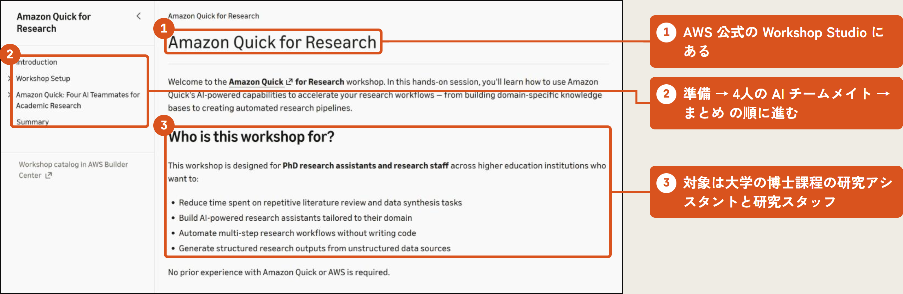
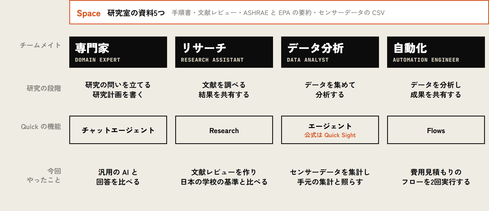
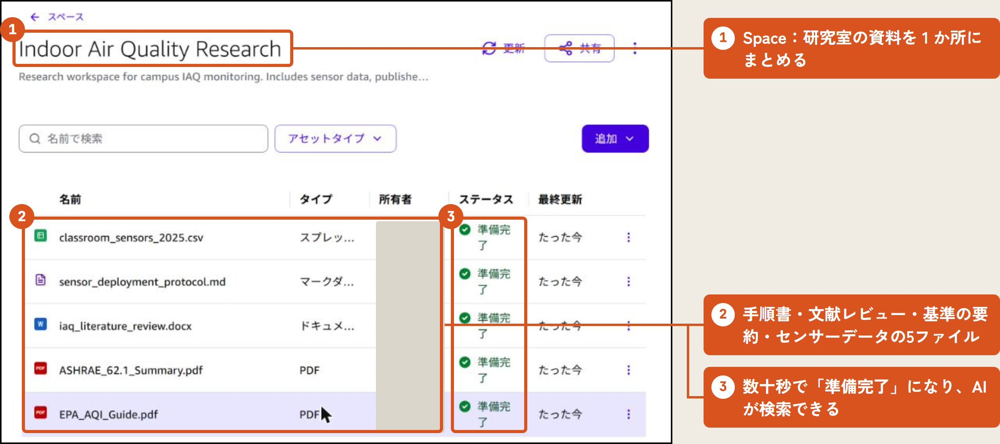
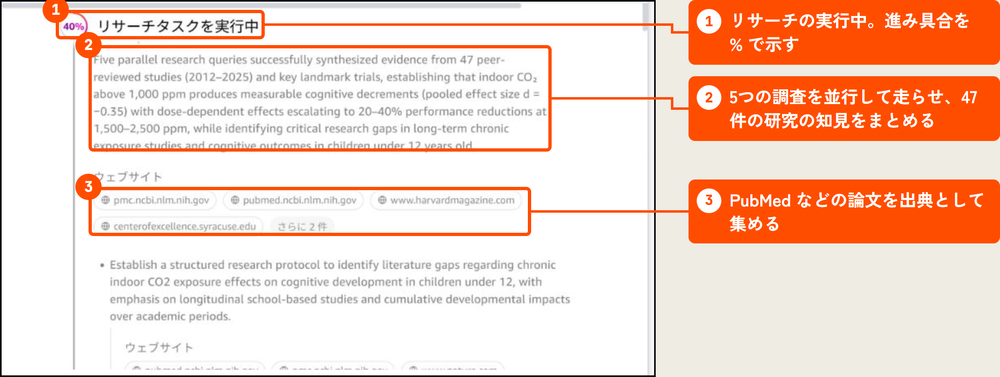
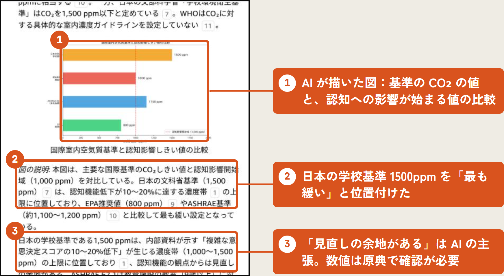
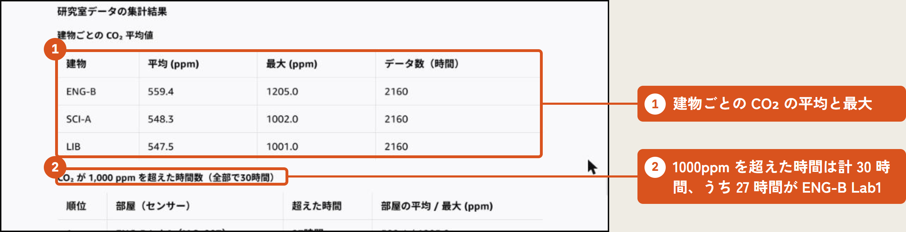
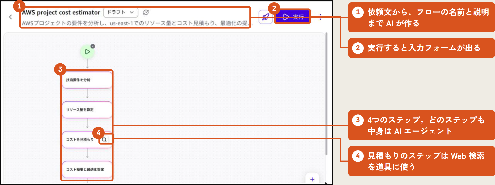
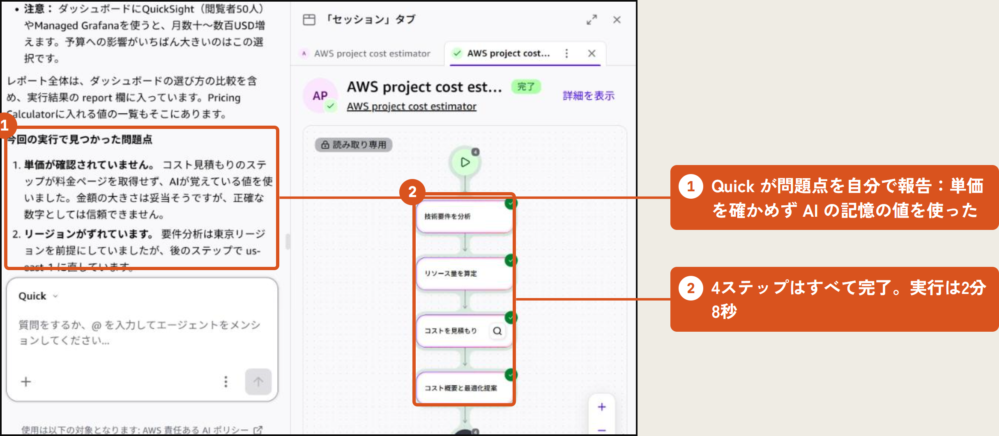
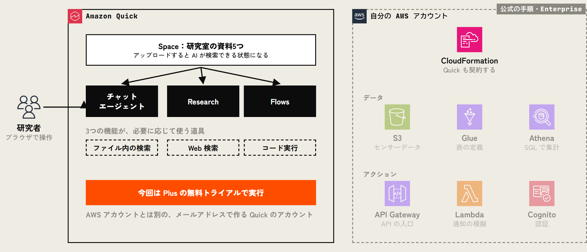
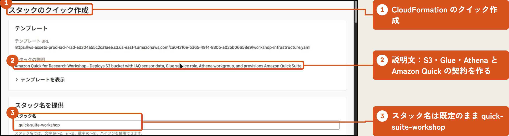

<!-- _class: cover -->
<!-- _header: '' -->
<!-- _paginate: false -->

REC

# 研究室に AI の同僚を 4人.

AWS 公式ハンズオン「Amazon Quick for Research」をやってみた発表者名

<!--
【ノート】20秒。
こんにちは。今日は、AWS が公式に公開している研究者向けのハンズオン「Amazon Quick for Research」を、実際に自分の手で最後まで動かしてみた話をします。
タイトルの「AI の同僚を 4 人」というのは、このワークショップが Amazon Quick の機能を「4 人の AI チームメイト」として紹介しているところから来ています。
まず、どんなワークショップなのかを見てみましょう。
-->

---

00

題材

## ワークショップの概要

AWS 公式の、大学の研究アシスタントと研究スタッフ向けの<em>約 2.5 時間</em>のハンズオン。

出典：<a href="https://catalog.us-east-1.prod.workshops.aws/workshops/ca04310e-b365-49f4-830b-a02bb06658e9/en-US">Amazon Quick for Research｜AWS Workshop Studio</a>

<!--
【ノート】40秒。
これがワークショップのトップページです。AWS の公式ワークショップのサイト、Workshop Studio に置かれています。
対象は、大学の博士課程の研究アシスタントや研究スタッフです。文献レビューやデータの整理といった繰り返しの作業を減らし、自分の分野に合わせた AI アシスタントを、コードを書かずに作ることを目指しています。
所要時間は約 2.5 時間。AWS のイベントでは用意されたアカウントで進めますが、自分の AWS アカウントでも進められる手順が付いています。
今日はこのワークショップを、4 つのトラックに分けて紹介します。
-->

---

<!-- _header: '' -->

### Tracklist

01背景

024人のチームメイト

03仕組み

04使うときの注意

<!--
【ノート】15秒。
流れはこの 4 つです。まず文教の現場の背景、次にワークショップの中心である 4 人のチームメイト、それから技術的な仕組み、最後に費用や後片付けといった使うときの注意です。
（配分：表紙と概要と目次で約 1 分半、TRACK 01 が約 2 分半、02 が約 9 分半、03 が約 4 分半、04 が約 4 分半。合計は約 22 分。持ち時間が短いときは、03 を「全体の構成」と「1 回の処理」の 2 枚に、02 の各チームメイトを 1 枚ずつに絞る）
では背景からです。
-->

---

<!-- _class: t1 dark eye -->

01

### Background

背景

<b>研究者</b>研究に使いたい時間

→

<b>実際は？</b>教育・学内事務・資料づくり

<!--
【ノート】10秒。
最初のトラックは背景です。研究者が研究に使える時間は、実際どれくらいあるのでしょうか。
-->

---

<!-- _class: t1 dense -->

01

研究時間

## 研究時間の割合

大学教員が勤務時間のうち研究に使う割合は、約 20 年で <em>46.5% から 32.2%</em> に下がった。

2002 年度46.5%

2008 年度36.2%

2013 年度35.0%

2018 年度32.9%

2023 年度32.2%

大学等教員のフルタイム換算係数。2023 年度は 2025 年 1 月の再公表値

出典：<a href="https://www.mext.go.jp/content/20250116-mxt_chousei01-000046785_1.pdf">文部科学省「令和5年度 大学等におけるフルタイム換算データに関する調査」結果の再公表について</a>

<!--
【ノート】45秒。
文部科学省が 5 年ごとに行っている調査に、大学の教員が勤務時間のうち研究にどれくらい使っているかを測るものがあります。
2002 年度には 46.5% でしたが、2023 年度は 32.2% です。20 年ほどで、研究に使える時間の割合が 3 分の 2 くらいに減っています。
文部科学省は、教育活動や大学運営・学内事務の割合が増えたと分析しています。
ちなみに 2023 年度の値は、一度公表されたあと誤りが見つかって、2025 年 1 月に再公表されています。今日の数字は再公表のほうです。
研究以外の作業を AI に任せられないか。これがワークショップの出発点です。では、ワークショップが想定している研究室を見てみましょう。
-->

---

<!-- _class: t1 dense -->

01

題材

## ワークショップの研究室

舞台は、<em>教育施設の室内の空気</em>を研究する環境科学の研究室。資料は研究室の手順書・文献・センサーデータ。

研究テーマ教室の CO₂ 濃度と、学生の認知機能の関係

手元の資料センサー設置の手順書・47 件の研究の文献レビュー・ASHRAE と EPA の基準の要約・3 棟 9 台のセンサーの 1 か月分のデータ

頼まれごと文献とセンサーデータを素早くまとめ、週例の資料を作る仕組みを用意する

<!--
【ノート】40秒。
ワークショップの舞台は、教育施設、つまり学校や大学の建物の室内の空気を研究している研究室です。
研究テーマは、教室の CO₂ 濃度と学生の認知機能の関係。主人公はこの研究室の研究アシスタントで、指導教員から「文献とセンサーデータを素早くまとめて、週例ミーティングの資料を作れる仕組みを作ってほしい」と頼まれています。
手元にあるのは、センサーの設置手順書、47 件の研究をまとめた文献レビュー、空調や空気質の基準の要約、それから 3 つの建物に置いた 9 台のセンサーの 1 か月分のデータです。どれもワークショップが用意したサンプルです。
この「教室の空気」というテーマ自体が、実は日本の学校にも直結しています。
-->

---

<!-- _class: t1 dense -->

01

学校の空気

## 日本の学校の基準

日本の学校では、換気の基準として教室の CO₂ を <em>1500ppm 以下</em>に保つことが望ましいとされている。

1500<small>ppm</small>

学校環境衛生基準 文部科学省の告示。超えたら換気する

1000<small>ppm</small>

建築物環境衛生管理基準 特定建築物に当たる学校に適用

1000・1500<small>ppm</small>

ワークショップの 「警告」と「危険」の値

出典：<a href="https://www.mext.go.jp/content/20230817-mext_kenshoku-100000613_2.pdf">文部科学省「学校環境衛生管理マニュアル」平成 30 年度改訂版</a>・<a href="https://www.mext.go.jp/content/20220902-mxt_kouhou01-000004520_01.pdf">文部科学省 事務連絡 令和 4 年 9 月 2 日</a>

<!--
【ノート】45秒。
日本の学校には、学校保健安全法に基づく「学校環境衛生基準」があります。換気の基準として、教室の CO₂ は 1500ppm 以下であることが望ましい、とされています。文部科学省のマニュアルでは、1500ppm を超えたら換気を行うことになっています。
一方で、延べ床面積が大きい特定建築物に当たる学校には、ビル管理の法律の基準、おおむね 1000ppm 以下も適用されます。
ワークショップでも、1000ppm を「警告」、1500ppm を「危険」の値として扱っていました。
つまりこのワークショップの題材は、日本の学校や大学の施設管理や保健の現場と、そのままつながるテーマです。
では、この研究室に来る 4 人の AI チームメイトを見ていきます。
-->

---

<!-- _class: t2 dark eye -->

02

### Four AI Teammates

4人のチームメイト

<b>研究室の資料</b>手順書・文献・データ

→

<b>4人の AI</b>それぞれ何ができる？

<!--
【ノート】10秒。
2 つ目のトラックは、ワークショップの中心、4 人のチームメイトです。研究室の資料を渡すと、それぞれ何をしてくれるのでしょうか。
-->

---

<!-- _class: t2 dense -->

02

チームメイト

## 4人のチームメイト

Space に入れた研究室の資料を、<em>専門家・リサーチ・データ分析・自動化</em>の 4 人がそれぞれのやり方で使う。

<!--
【ノート】45秒。
これが全体像です。土台になるのは「Space」です。研究室の資料をまとめて入れておく場所で、ここに入れた資料を 4 人のチームメイトが使います。
1 人目の「専門家」は、研究室の資料に基づいて質問に答えるチャットエージェントです。
2 人目の「リサーチ」は、Web と研究室の資料を調べて、文献レビューのような報告書を書きます。
3 人目の「データ分析」は、センサーデータを集計します。公式の手順では Quick Sight というダッシュボードの機能を使いますが、今回は事情があってエージェントで代わりにやりました。理由は 4 つ目のトラックで話します。
4 人目の「自動化」は、Flows という機能で、決まった手順の作業をフローとして組み立てます。
一番下の段が、今回実際にやったことです。順番に見ていきます。まずは専門家です。
-->

---

<!-- _class: t2 dense -->

02

専門家

## 資料の準備

チームメイト：専門家リサーチデータ分析自動化

研究室の資料 5 つを Space に入れ、それを根拠に答えるチャットエージェントを作った。

<!--
【ノート】45秒。
最初に Space を作って、ワークショップのサンプル資料をアップロードしました。PDF が 2 つ、Word の文献レビュー、Markdown の手順書、それからセンサーデータの CSV です。数十秒で「準備完了」になり、AI が中身を検索できる状態になります。
次に、この Space を知識として使うチャットエージェントを作ります。名前は「IAQ Research Assistant」。指示文には、出典を示すこと、研究室の結果と一般的な知見を分けること、資料に無いことは推測せず「無い」と言うこと、日本語で答えること、を書きました。
今の Quick では、エージェントを作るのもチャットで頼む形になっていて、指示文は AI が清書してくれます。
では、このエージェントに質問してみます。
-->

---

<!-- _class: t2 dense -->

02

専門家

## 同じ質問への回答

チームメイト：専門家リサーチデータ分析自動化

同じ質問に、汎用の AI は<em>一般論</em>で、専門家エージェントは<em>研究室の手順書</em>で答えた。

| 回答の中身 | 汎用の Quick | 専門家エージェント |
|---|---|---|
| 根拠 | Web と一般的な知識 | 研究室の手順書 v2.1 の第 6 節 |
| 測る間隔 | 目的別に 1 分・1〜5 分・5〜10 分 | 生データは 1 分、集計は 5 分 |
| センサー | 機種を教えてほしいと聞き返す | SenseAir S8・精度は ±40ppm と読み値の 3% |
| 校正の頻度 | 半年から 1 年に 1 回が目安 | ゼロ点は毎月・全面的な校正は 6 か月ごと |

質問：教室での CO₂ の連続モニタリングで推奨されるサンプリング間隔と、センサーの校正の手順は？ 2026-11-17 に実行

<!--
【ノート】50秒。
ワークショップの最初の演習は、同じ質問を、エージェントを使わない素の Quick と、作った専門家エージェントに聞いて比べるものです。質問は「教室で CO₂ を連続して測るとき、推奨される間隔と校正の手順は？」です。
素の Quick は Web 検索をして、目的別に 1 分から 10 分といった一般論を表にまとめてくれました。内容としては正しいのですが、センサーの機種は「教えてくれれば調べます」と聞き返してきます。
専門家エージェントは、研究室の手順書の版と節まで示して、「生データは 1 分、集計は 5 分」「センサーは SenseAir S8」「ゼロ点は毎月、全面的な校正は 6 か月ごと」と答えました。研究室の決まりで答えている、という違いです。
しかも、この回答には続きがありました。
-->

---

<!-- _class: t2 dense -->

02

専門家

## 資料どうしの照合

チームメイト：専門家リサーチデータ分析自動化

回答の中で、センサーデータが<em>手順書の間隔と合わない</em>ことまで指摘した。

<!--
【ノート】40秒。
①で手順書の名前と版を示し、②で第 6 節の内容を引用しています。
注目してほしいのは③です。Space に入っているセンサーデータの CSV は 1 時間刻みなのに、手順書では 1 分ごとに測ることになっている。「資料どうしで合っていません。1 時間平均に集計し直したデータだと思われますが、説明がありません」と、聞いてもいないのに指摘してくれました。
新しく研究室に入った人が、手順書とデータの食い違いに最初から気づくのは難しいので、これは助かる指摘です。
では、資料にそもそも書かれていないことを聞くとどうなるでしょうか。
-->

---

<!-- _class: t2 dense -->

02

専門家

## 資料に無い質問

チームメイト：専門家リサーチデータ分析自動化

資料に無い数値を聞くと、推測で埋めずに<em>「情報がない」</em>と答えた。

<!--
【ノート】35秒。
ワークショップには、エージェントの限界を試す演習もあります。「私たちの 2024 年の研究で、CO₂ が 1200ppm を超えたときとワーキングメモリの相関の p 値は？」と聞きます。こんな研究は資料に入っていません。
エージェントは「アップロード資料には、その p 値の情報がありません」と答え、推測の値も出しませんでした。そのうえで「論文や解析結果を Space に入れてくれれば、そこから抜き出します」と提案してきます。
研究の場面では、もっともらしい数字を作られるのが一番困るので、ここは大事なポイントです。
次は 2 人目、リサーチです。
-->

---

<!-- _class: t2 dense -->

02

リサーチ

## 調査計画への指示

チームメイト：専門家リサーチデータ分析自動化

Research が作った調査計画に、<em>日本の学校の基準と比べる節</em>を人が足してから実行した。

研究者教育環境での CO₂ 濃度と認知機能の関係について、研究デザイン・しきい値・認知課題・交絡因子の観点で文献レビューをして。研究室の資料も参照して

AI計画を作りました。対象読者・内部資料の形式・長期暴露の定義を教えてください

研究者読者は教育関係者と研究者。長期暴露は 1 学年以上。ASHRAE・WHO と日本の学校環境衛生基準を比べる節も追加して

やり取りは要約。リサーチの目標はワークショップの文を日本語に訳したもの

<!--
【ノート】45秒。
リサーチは、Web と研究室の資料をまとめて調べて、報告書を書く機能です。
ワークショップの目標の文を日本語に訳して、教育環境での CO₂ と認知機能の関係について文献レビューを頼みました。いきなり走らせず、まず調査計画を見せてもらえます。
AI のほうから「読者は誰か」「長期暴露とはどれくらいの期間か」と確認が来たので答えつつ、私はここで 1 つ注文を足しました。「海外の基準と、日本の学校環境衛生基準を比べる節を追加して」です。
人が計画の段階で、日本の文脈を差し込めるのがポイントです。では実行してみます。
-->

---

<!-- _class: t2 dense -->

02

リサーチ

## 調査の実行

チームメイト：専門家リサーチデータ分析自動化

高速モードで <em>10 分以内</em>に、5 つの調査を並行して進め、論文を出典として集めた。

<!--
【ノート】30秒。
実行中の画面です。①進み具合がパーセントで出て、②5 つの調査を並行して走らせ、③PubMed などの論文のページを出典として集めていきます。
今回は速さ重視の「高速」モードで、10 分かからずに終わりました。ワークショップでは、本番の文献レビューなら 20〜30 分かかる「詳細」モードを使うよう勧めています。
出来上がった報告書を見てみます。
-->

---

<!-- _class: t2 dense -->

02

リサーチ

## 報告書の中身

チームメイト：専門家リサーチデータ分析自動化

報告書は日本の学校の基準を各国の値と並べて図にしたが、<em>数値の一部は原典での確認が必要</em>だった。

<!--
【ノート】45秒。
報告書は日本語で、研究デザインの比較、しきい値、研究のギャップといった章立てになっていました。私が足した基準の比較の節もちゃんと入っていて、①のように、基準の値と認知への影響が始まる値を比べる図まで描いてくれました。
②と③では、日本の学校基準の 1500ppm を「最も緩い」「見直しの余地がある」と書いています。これは AI の主張です。
それに、細かく見ると、日本の基準は「1500ppm 以下が望ましい」なのに「定めている」と書いていたり、EPA の値の根拠が私には確かめきれなかったりしました。報告書は下書きとして使い、数値は原典で確かめる必要があります。
次は 3 人目、データ分析です。
-->

---

<!-- _class: t2 dense -->

02

データ分析

## センサーデータの集計

チームメイト：専門家リサーチデータ分析自動化

建物ごとの CO₂ の平均と 1000ppm を超えた時間を集計させると、<em>手元での集計と一致</em>した。

発表者が手元の Python で同じ CSV を集計した値：ENG-B 559・SCI-A 548・LIB 547ppm、1000ppm 超えは Lab1 が 27 時間・他の 3 部屋が各 1 時間

<!--
【ノート】45秒。
公式の手順では、センサーデータを Athena という SQL のサービスにつなぎ、Quick Sight でダッシュボードを作ります。今回はそれができない環境だったので、CSV を Space に入れて、専門家エージェントに直接聞きました。
「建物ごとの CO₂ の平均と、1000ppm を超えた時間が多い部屋は？」と聞くと、①建物ごとの平均と最大、②超えた 30 時間のうち 27 時間が工学棟の Lab1 に集中している、という表を返してきました。
AI の数字をそのまま信じるわけにはいかないので、私も手元で同じ CSV を集計しましたが、平均値も時間数も完全に一致しました。
どうやって計算したのかは、3 つ目のトラックで中身を見せます。最後の 4 人目、自動化です。
-->

---

<!-- _class: t2 dense -->

02

自動化

## フローの生成

チームメイト：専門家リサーチデータ分析自動化

依頼文 1 つから、研究プロジェクトの <em>AWS の費用を見積もるフロー</em>を AI が 4 ステップで組んだ。

<!--
【ノート】40秒。
自動化の演習では、研究プロジェクトの AWS の費用を見積もるフローを作ります。研究費の申請で、クラウドの費用を見積もる場面を想定したものです。
ワークショップの依頼文をそのまま貼ると、①フローの名前と説明、③の 4 つのステップを AI が組み立てました。技術要件の分析、リソース量の算定、コストの見積もり、まとめと最適化の提案です。④見積もりのステップには Web 検索の道具が付いています。
入力には、今回の題材に合わせて「キャンパスの 30 教室に CO₂ センサーを置き、1 分ごとのデータを 5 年保存する。月 100 ドル以内」と書きました。
実行した結果がこちらです。
-->

---

<!-- _class: t2 dense -->

02

自動化

## AI の自己点検

チームメイト：専門家リサーチデータ分析自動化

1 回目の見積もりは月 3.32 USD。Quick は<em>「単価を確かめず、記憶の値を使った」</em>と自ら報告した。

<!--
【ノート】40秒。
フローは 2 分ほどで終わり、見積もりは月 3.32 ドルでした。IoT Core から S3 に保存して、Athena で集計し、ダッシュボードは S3 と CloudFront の静的ページ、という構成です。
面白かったのは、結果のあとに Quick が自分で「問題点」を挙げてきたことです。「コスト見積もりのステップが料金のページを取得せず、AI が覚えている単価を使った」「リージョンが途中でずれた」「監視の費用が入っていない」。
そして「単価の Web での確認を必須にしますか？」といった改善案を出してきます。私はこれを採用して、もう一度動かしました。
-->

---

<!-- _class: t2 dense -->

02

自動化

## 修正と再実行

チームメイト：専門家リサーチデータ分析自動化

人が改善案を選んで同じ入力で再実行すると、<em>前提が変わって月 206.33 USD</em> になった。

| 比べたこと | 1 回目 | 2 回目 |
|---|---|---|
| 月額の見積もり | 3.32 USD | 206.33 USD |
| ダッシュボードの前提 | S3 と CloudFront の静的ページ | Quick Sight・閲覧者 50 人と作成者 2 人 |
| 監視とセキュリティの費用 | 合計に入っていない | CloudWatch・KMS などを合計に入れた |
| 単価の確かめ方 | AI が覚えている値 | 料金ページを読めず、多くが「未確認」 |

2 回目の後、Quick は「ダッシュボードの前提が実行のたびに変わる」「AWS の公開の料金データから単価を読むべき」と報告した

<!--
【ノート】50秒。
改善版で同じ入力をもう一度流すと、今度は月 206 ドルになりました。60 倍です。
原因は、2 回目の AI がダッシュボードに Quick Sight を選んだことでした。閲覧者 50 人分のライセンスだけで月 198 ドル、全体の 96% です。監視の費用はちゃんと入るようになり、リージョンのずれもなくなりました。
ただ、単価の確認はまだ駄目でした。AWS の料金ページは、表の数字をスクリプトで後から表示する作りなので、フローの読み込み方では数字が取れなかったそうです。Quick 自身が「公開されている料金データのファイルから読むべき」と次の改善案を出しています。
フローは速く作れますが、前提を人が決めて固定しないと、結果は大きくぶれる、ということがよく分かりました。
-->

---

<!-- _class: t2 -->

02

チームメイト

作業は AI が速く、 前提は人が決める。

| チームメイト | AI がした作業 | 人が判断したこと |
|---|---|---|
| 専門家 | 資料を探し、出典つきで答える | 何を資料として渡すか |
| リサーチ | 論文を集め、報告書を書く | 調べる観点と、数値の確かめ |
| データ分析 | コードを書いて集計する | 集計結果の検算 |
| 自動化 | フローを組み、自分で点検する | 見積もりの前提と、改善案の採用 |

<!--
【ノート】40秒。
4 人のチームメイトをまとめると、「作業は AI が速く、前提は人が決める」です。
専門家は資料を探して答えますが、何を資料として渡すかは人が決めます。リサーチは論文を集めて書きますが、どの観点で調べるか、数値が正しいかは人が見ます。データ分析の集計は人が検算し、自動化のフローでは、見積もりの前提と改善案を採るかどうかを人が決めました。
では、これらが裏側でどう動いているのか。3 つ目のトラック、仕組みです。
-->

---

<!-- _class: t3 dark eye -->

03

### How It Works

仕組み

<b>画面の操作</b>質問・計画・フロー

→

<b>裏側では？</b>何がどう動いている？

<!--
【ノート】10秒。
3 つ目のトラックは仕組みです。画面の裏側で、何がどう動いていたのかを見ていきます。
-->

---

<!-- _class: t3 dense -->

03

構成

## 全体の構成

Quick の 3 つの機能が Space の資料を使い、公式の手順では<em>自分の AWS アカウント</em>にもつなぐ。

公式ワークショップの構成図をもとに発表者が描き直した。右の AWS 側は、今回の Plus の環境ではつないでいない

<!--
【ノート】50秒。
全体の構成です。左が Amazon Quick の中です。研究者がブラウザで操作し、Space の資料を、チャットエージェント、Research、Flows の 3 つの機能が使います。それぞれ、ファイル内の検索、Web 検索、コード実行といった道具を、必要に応じて使い分けます。
右は、公式の手順で自分の AWS アカウントに作るものです。センサーデータを置く S3、表の定義を持つ Glue、SQL で集計する Athena。それから、AI が通知やチケット作成を実行するための API を、API Gateway・Lambda・Cognito で作ります。
今回、私は Quick を Plus という無料トライアルで動かしたので、右側にはつないでいません。その理由は 4 つ目のトラックで話します。まず、公式の手順で AWS 側をどう作るかを見ます。
-->

---

<!-- _class: t3 dense -->

03

構成

## 公式の準備手順

マネジメントコンソールの CloudFormation で、テンプレートを開いて作成するだけで準備が終わる。

<!--
【ノート】35秒。
公式の、自分のアカウントで進める手順では、ワークショップのページにあるボタンを押すと、CloudFormation のクイック作成の画面が開きます。①です。
②の説明文にあるとおり、このテンプレート 1 つで、S3、Glue、Athena を作り、さらに Amazon Quick の契約まで作ります。③のスタック名は既定のままで、IAM ロールを作ることを承認して「スタックの作成」を押すだけです。5 分ほどで終わりました。
手軽ですが、中で何をしているかは知っておいたほうがいいので、テンプレートを読んでみました。
-->

---

<!-- _class: t3 dense -->

03

構成

## テンプレートの中身

スタックの中の Lambda が、Quick の契約と、<em>アカウント全体の設定</em>の変更まで行う。

quicksight.create_account_subscription(
  Edition='ENTERPRISE',
  AuthenticationMethod='IAM_ONLY', ...)①
quicksight.update_spice_capacity_configuration(
  PurchaseMode='AUTO_PURCHASE')②
lf.put_data_lake_settings(DataLakeSettings={
  'DataLakeAdmins': current_admins, ...})③

①<b>Quick の契約</b>　Enterprise で契約する。スタックを消しても契約は残る

②<b>容量の自動購入</b>　Quick のデータ保存領域が足りないと自動で買い足す

③<b>Lake Formation</b>　自分の Lambda 用のロールをデータレイクの管理者に加える

workshop-infrastructure.yaml の Lambda のコードから抜粋・一部省略

<!--
【ノート】50秒。
テンプレートの中の Lambda のコードを抜粋しました。
①で Quick の契約を作っています。エディションは Enterprise です。ワークショップのまとめのページにも書かれていますが、スタックを消しても、この契約は残ります。解約は別に CLI で行う必要があります。
②では、Quick のデータ保存領域、SPICE が足りなくなったら自動で買い足す設定にしています。
③は、アカウント全体の Lake Formation の設定に、自分のロールをデータレイクの管理者として加えています。
どれもワークショップを動かすには必要な処理ですが、普段使っているアカウントで動かすなら、後片付けで元に戻すものが増えます。これも 4 つ目のトラックで話します。
次は、専門家エージェントが 1 回の質問で何をしていたかです。
-->

---

<!-- _class: t3 dense -->

03

エージェント

## 1 回の処理

日本語の検索語では 0 件で、<em>英語に言い換えた検索語</em>で手順書が見つかり、それを出典に答えた。

<!--
【ノート】45秒。
さっきのサンプリング間隔の質問で、裏側で何が起きていたかです。画面の「ファイルを検索しました」を開くと、検索の履歴が見られます。
入力は日本語の質問と、エージェントの指示文、それに Space の資料です。Quick はまず日本語のまま「CO2 連続モニタリング サンプリング間隔」で資料を検索して、0 件でした。資料が英語だからです。
すると自分で英語に言い換えて、「CO2 sensor calibration procedure sampling interval classroom」で検索し直し、8 件見つけて、手順書を出典に答えています。
日本の研究室でも、英語の論文や海外の手順書をそのまま入れて、日本語で質問できる、ということです。
次は、データ分析の集計の中身です。
-->

---

<!-- _class: t3 dense -->

03

データ分析

## 集計のコード

エージェントは CSV を <em>pandas で読み込むコード</em>を書いて実行し、その出力から答えた。

<!--
【ノート】40秒。
集計の回答には「1 件の成果物を作成」と出ていて、開くとコードが入っていました。②です。
③のとおり、エージェントは Python の pandas で CSV を読み込み、建物ごとに平均・最大・件数を出し、1000ppm を超えた行を部屋ごとに数えるコードを書いて、実行していました。
AI が数字を「読んで」答えたのではなく、コードで計算していたので、手元の集計と一致したわけです。コードが見えるので、どう計算したかを人が後から確かめられます。
最後に、フローの中身です。
-->

---

<!-- _class: t3 dense -->

03

自動化

## フローの中身

フローの各ステップは AI エージェントで、料金の確認に Web 検索を使うが、<em>料金ページの数字は読み取れなかった</em>。

ステップ入力 4 項目 → 要件の分析 → 量の算定 → 見積もり → まとめ。どれもエージェント

計算ツールAWS Pricing Calculator は画面の操作が要るため、フローは操作せず、入力する値の一覧を返す

料金ページ表の数字をスクリプトで表示する作りのため、Web 検索の読み込みでは単価が取れなかった

次の改善案AWS が公開している料金データのファイル、Price List から単価を読む

<!--
【ノート】45秒。
フローは、入力フォームの 4 項目から始まって、要件の分析、量の算定、見積もり、まとめの 4 ステップで、どのステップも中身は AI エージェントでした。
ワークショップの説明では、見積もりのステップで AI が AWS Pricing Calculator を操作することになっていますが、今回のフローは「計算ツールは対話的なブラウザが要るので操作しない。代わりに入力する値の一覧を返す」と説明していました。
単価の確認がうまくいかなかったのは、AWS の料金ページが、表の数字をスクリプトで後から表示する作りだったからです。次の改善案として、AWS が公開している料金データのファイルから読むことを勧めていました。
さて最後のトラックです。使うときの注意です。
-->

---

<!-- _class: t4 dark eye -->

04

### Before You Try

使うときの注意

<b>試してみたい</b>研究室で使えそう

→

<b>その前に</b>費用・制約・後片付け

<!--
【ノート】10秒。
4 つ目のトラックは、使うときの注意です。試してみたくなったところで、費用、制約、後片付けを押さえておきます。
-->

---

<!-- _class: t4 dense -->

04

費用

## プランと料金

AWS アカウントで契約するプランには、ユーザーの料金に加えて<em>アカウントごとに月 250 USD</em>のインフラ料金がかかる。

| プラン | 料金 | 登録のしかた | AWS との接続 |
|---|---|---|---|
| Free | 0 USD | メールアドレスなど | なし |
| Plus | 1 人 月 20 USD・年払いの場合 | メールアドレスなど | なし |
| Professional | 1 人 月 20 USD と 月 250 USD | AWS のコンソール | あり |
| Enterprise | 1 人 月 40 USD と 月 250 USD | AWS のコンソール | あり・ダッシュボードの作成 |

2026-11-17 時点の価格表。Plus は月払いなら 1 人 月 25 USD。新規の登録には 30 日の無料トライアルがある

出典：<a href="https://aws.amazon.com/quick/pricing/">Amazon Quick の料金</a>・<a href="https://aws.amazon.com/quick/faqs/">Amazon Quick よくある質問</a>

<!--
【ノート】50秒。
Amazon Quick には大きく 2 種類の入り方があります。
上の 2 つ、Free と Plus は、メールアドレスや Google アカウントで登録する個人やチーム向けのプランで、AWS アカウントもクレジットカードも要りません。
下の 2 つ、Professional と Enterprise は、AWS のコンソールから契約する組織向けのプランで、AWS のデータにつなげます。ただし、ユーザーごとの料金に加えて、アカウントごとに月 250 ドルのインフラ料金がかかります。
公式のテンプレートが作るのは、一番下の Enterprise です。1 人でも月 290 ドルになります。
どちらにも 30 日の無料トライアルがあるのですが、ここで少しつまずきました。
-->

---

<!-- _class: t4 dense -->

04

費用

## 今回の進め方

公式の手順で作った Enterprise は無料トライアルかどうかを画面で確かめられず、<em>当日に解約して Plus に切り替えた</em>。

1. CloudFormation で Enterprise を契約
2. 管理画面にトライアルの表示がない
3. CLI でその場で解約
4. <em>カードを登録しない Plus の無料トライアル</em>で実行

<!--
【ノート】50秒。
公式のドキュメントには「初めて登録すると 25 ユーザーまで 30 日の無料トライアル」と書いてあります。そこで公式の手順どおりスタックを作ったのですが、Quick の管理画面のどこにも「トライアル中」という表示がなく、課金の情報も反映までに時間がかかるので、本当に無料なのか確かめられませんでした。
月 290 ドルかかる可能性を抱えたまま進めるのは避けたかったので、契約はその場で CLI で解約しました。
代わりに、メールアドレスで登録する Plus の無料トライアルに切り替えました。こちらはクレジットカードを登録しないので、料金がかかりようがありません。右の画面のとおり、30 日で期限が切れる表示が出ます。
ただし、Plus にしたことで、できなくなったこともあります。
-->

---

<!-- _class: t4 dense -->

04

制約

## Plus でできないこと

Plus では AWS のデータや自作の API につなげないため、公式の演習のうち <em>2 つを置き換え・省略</em>した。

| 公式の演習 | Plus での扱い |
|---|---|
| Quick Sight で Athena のセンサーデータからダッシュボードを作る | CSV を Space に入れ、エージェントに集計させた |
| OpenAPI のコネクタで、通知やチケット作成の API を呼ぶ | 自作できるのは MCP のコネクタだけだったため省略した |
| 研究倫理審査の書類を扱うエージェント・共有・Quick Automate | 時間の都合で省略した |

Plus で AWS の基盤につなげない点は FAQ の記載による。コネクタの種類は 2026-11-17 の画面で確認

<!--
【ノート】40秒。
Plus で置き換えたのは 2 つです。
1 つ目は、Athena にあるセンサーデータから Quick Sight でダッシュボードを作る演習です。AWS の基盤につなぐのは Professional と Enterprise の機能なので、今日見せたように、CSV を Space に入れてエージェントに集計させる形に置き換えました。
2 つ目は、AI から通知やチケット作成の API を呼ぶ演習です。Plus の画面で自作できるコネクタは MCP 形式だけで、ワークショップの OpenAPI 形式の API はつなげなかったので、省きました。
ほかに、研究倫理審査のエージェントや Automate などの追加の演習は、時間の都合で省いています。
そして、動かしたら後片付けです。
-->

---

<!-- _class: t4 dense -->

04

後片付け

## 後片付け

スタックと契約を消すだけでなく、<em>スタックの外で変わった設定</em>も元に戻した。

| 対象 | やったこと | 確認した結果 |
|---|---|---|
| Quick の Enterprise の契約 | 削除保護を外して CLI で解約 | UNSUBSCRIBED |
| CloudFormation のスタック | バージョン管理された S3 を空にして削除 | スタックなし |
| Lake Formation の管理者 | 追加されたロールを外す | 管理者なし・作業前と同じ |
| Quick 用のサービスロール | スタックの外で作られたため手で削除 | ロールなし |
| Lambda のロググループ | スタックを消しても残るため削除 | ロググループなし |
| Plus で作ったもの | Space・エージェント・フロー・リサーチを削除 | どの一覧も空 |

<!--
【ノート】50秒。
後片付けでやったことです。
ワークショップの手順にあるのは、スタックの削除と、Quick の契約の解約です。契約は削除保護を外してから CLI で解約し、状態が UNSUBSCRIBED になったことを確かめました。S3 はバージョン管理が有効なので、古い版まで消してから削除します。
加えて、手順には書かれていないものが 3 つありました。テンプレートが加えた Lake Formation の管理者、Lambda がスタックの外で作った Quick 用のロール、それからスタックを消しても残る Lambda のログです。作業前の状態を記録しておいたので、それと同じに戻しました。
普段使っているアカウントで試すなら、作業前の状態を控えておくのがおすすめです。
最後に、AI の出力の確かめ方をまとめます。
-->

---

<!-- _class: t4 dense -->

04

確かめ方

## 出力の確かめ方

AI の出力は、<em>確かめ方を決めてから</em>研究に使う。

| AI の出力 | 確かめた方法 | 結果 |
|---|---|---|
| センサーデータの集計 | 手元の Python で同じ CSV を集計した | 平均・時間数とも一致 |
| 報告書の基準の数値 | 文部科学省の告示とマニュアルを読んだ | 日本の 1500ppm は一致・「望ましい」が正しい |
| 費用の見積もり | Quick 自身の点検の報告を読んだ | 単価は未確認と自ら報告 |

<!--
【ノート】40秒。
今回、AI の出力をどう確かめたかを並べます。
データの集計は、手元で同じ計算をして一致を確かめました。報告書の基準の数値は、文部科学省の告示とマニュアルを読んで、1500ppm という値は合っていること、ただし「定めている」ではなく「望ましい」が正しいことを確かめました。費用の見積もりは、Quick 自身が単価は未確認だと報告してくれたので、そのまま研究費の申請には使えないと判断できます。
AI が速く出してくれるぶん、確かめ方を先に決めておくのが大事だと感じました。
-->

---

<!-- _class: t4 -->

04

使うときの注意

まず無料で試し、 確かめてから使う。

| 注意点 | 今回やったこと |
|---|---|
| 費用 | 料金が確かめられない契約は当日に解約し、Plus の無料トライアルで試した |
| 制約 | Plus でつなげない AWS のデータは、CSV を Space に入れて代わりにした |
| 後片付け | 作業前の状態を控え、スタックの外で変わった設定まで戻した |
| 確かめ方 | 集計は検算し、報告書の数値は原典と照らした |

<!--
【ノート】30秒。
4 つ目のトラックのまとめは「まず無料で試し、確かめてから使う」です。
費用は、確かめられない契約はすぐ解約して、無料トライアルで試す。制約は、つなげないデータを CSV で代わりにする。後片付けは、作業前の状態を控えて、設定まで戻す。そして出力は、検算と原典で確かめる。
-->

---

<!-- _class: cover -->
<!-- _header: '' -->
<!-- _paginate: false -->

END

# 研究室の資料を Space に 入れてみよう.

ワークショップ：Amazon Quick for Research｜AWS Workshop Studioこの資料は <b>CLAUDE CODE</b> と作りました

<!--
【ノート】20秒。
研究に使える時間が減っている今、研究室の手順書や文献を 1 つの Space に入れるだけで、出典つきで答える同僚が 1 人増えます。Plus の無料トライアルならクレジットカードも要りません。
ぜひ、皆さんの研究室の資料を Space に入れてみてください。ありがとうございました。
-->

---

<!-- _class: t4 dense appendix -->

04

付録

## 付録：実行の記録

発表では使いません。質疑や後から読まれるときの手元資料です。今回の環境と、AI に渡した入力をまとめます。

| 項目 | 内容 |
|---|---|
| 実施日 | 2026 年 11 月 17 日。AWS の Enterprise の契約は同日に作成し、作成から 1 時間以内に解約しました |
| Quick の環境 | Amazon Quick の Plus の無料トライアルです。メールアドレスで登録し、クレジットカードは登録していません |
| 使った資料 | ワークショップのサンプル 5 つです。EPA_AQI_Guide.pdf、ASHRAE_62.1_Summary.pdf、iaq_literature_review.docx、sensor_deployment_protocol.md、classroom_sensors_2025.csv |
| 質問の文 | ワークショップの英語の質問を、発表者が日本語に訳して入力しました |
| エージェントの指示 | 出典を示す、研究室の結果と一般的な知見を分ける、資料に無いことは推測せずに明言する、日本語で答える、の 4 点を伝え、指示文は Quick が清書しました |
| リサーチ | 高速モード。材料は Web 検索と Space です。計画の段階で、日本の学校環境衛生基準と比べる節を追加しました |
| フローの入力 | キャンパスの 30 教室に CO₂ と PM2.5 のセンサーを置き、1 分ごとのデータを 5 年保存する。閲覧者 50 人、月 100 USD 以内、サーバーレスを優先 |

<b>注</b>　AI の出力は実行のたびに変わります。数値や表現は、記録した日の 1 回の結果です。

<!--
【ノート】付録。発表では使わない。質疑で聞かれたときの手元資料。
-->

---

<!-- _class: t4 dense appendix -->

04

付録

## 付録：出典

本編で使った数値と仕様の出典です。

| 内容 | 出典 |
|---|---|
| ワークショップの手順・構成図・テンプレート | <a href="https://catalog.us-east-1.prod.workshops.aws/workshops/ca04310e-b365-49f4-830b-a02bb06658e9/en-US">Amazon Quick for Research｜AWS Workshop Studio</a> |
| 大学教員の研究時間の割合 | <a href="https://www.mext.go.jp/content/20250116-mxt_chousei01-000046785_1.pdf">文部科学省 令和5年度 大学等におけるフルタイム換算データに関する調査 結果の再公表</a> |
| 学校の CO₂ の基準 | <a href="https://www.mext.go.jp/content/20230817-mext_kenshoku-100000613_2.pdf">文部科学省 学校環境衛生管理マニュアル 平成30年度改訂版</a> |
| 特定建築物の CO₂ の基準 | <a href="https://www.mext.go.jp/content/20220902-mxt_kouhou01-000004520_01.pdf">文部科学省 事務連絡 令和4年9月2日</a> |
| Quick の料金とプラン | <a href="https://aws.amazon.com/quick/pricing/">Amazon Quick の料金</a>・<a href="https://aws.amazon.com/quick/faqs/">Amazon Quick よくある質問</a> |
| Quick の無料トライアル | <a href="https://docs.aws.amazon.com/quick/latest/userguide/signing-up.html">Signing up through the AWS Console｜Amazon Quick ユーザーガイド</a> |

<b>注</b>　法令や基準の解釈は発表者が調べて整理したものです。実際に使うときは原典と専門家に確かめてください。

<!--
【ノート】付録。発表では使わない。質疑で聞かれたときの手元資料。
-->
