<!-- _class: cover -->
<!-- _header: '' -->
<!-- _paginate: false -->

# 研究プロセスへの AI 活用

AWS Quick で研究の 5 フェーズを一巡させた実践発表者名

<!--
【ノート】15秒。
よろしくお願いします。今日は、大学の研究プロセスに AI をどう組み込めるかを、AWS Quick というサービスで実際に試した結果をもとにお話しします。
まず、この発表の要点からです。
-->

---

<!-- _class: dense -->

00

概要

## この発表の要点

研究時間の量は増やしにくい。そこで、研究時間の中の<em>付帯業務を AI に任せる</em>ことを、AWS Quick で実際に試した。

現状大学教員の研究時間の割合は約 20 年で 46.5% から 32.2% に低下した。主因は教育と診療の増加

方針文部科学省は、研究プロセスの自動化を AI for Science の政策目的の第一に掲げた

実践AWS Quick で研究の 5 フェーズを 3 分 30 秒で一巡させた。計画の前提の誤りは人が正す必要があった

判断材料個人なら無料で試せる。学内のデータに接続する段階で組織向けのプランを検討する

<!--
【ノート】45秒。
最初に結論をお伝えします。
大学の先生が研究に使える時間の割合は、この 20 年で大きく下がりました。ただ、その主な原因は教育と診療の増加で、先生個人の工夫ではなかなか取り戻せません。
そこで発想を変えて、残った研究時間の中にある付帯業務、たとえば文献の整理や申請書類、データ管理計画などを AI に任せられないか。国も、研究プロセスの自動化を AI 政策の第一の目的に掲げています。
これを AWS Quick というサービスで実際に試したところ、研究の 5 つのフェーズを 3 分 30 秒で一巡できました。ただし、計画の前提の誤りは人が見つけて直す必要がありました。
最後に、導入するときに何を判断すればよいかもお話しします。
-->

---

<!-- _header: '' -->

### Tracklist

01研究時間の現状と国の方針

02研究プロセスと AI の分担

03AWS Quick の概要

04研究プロセスを AWS Quick で一巡させる

05導入の判断材料

<!--
【ノート】20秒。
前半の 2 つのトラックは、何をすべきかの話です。研究時間の現状と国の方針、そして研究プロセスのどこを AI に任せるかを整理します。
後半の 3 つは、どう実現するかの話です。AWS Quick の機能を画面で紹介し、実際に研究プロセスを一巡させた結果と、導入の判断材料をお見せします。
（配分の目安：表紙から目次まで 1 分半、TRACK 01 が 8 分半、02 が 3 分、03 が 12 分、04 が 12 分、05 が 6 分、締めが 1 分。合計は約 44 分。持ち時間が短いときは、01 の分野別と決まり、03 のエージェントの 3・4 枚目と Research の 3 枚目、04 の応用、05 の公式テンプレートを省く）
では、研究時間の現状からです。
-->

---

<!-- _class: t1 dark eye -->

01

### Background

研究時間の現状と国の方針

<!--
【ノート】10秒。
最初のトラックでは、大学の研究時間がどう変わってきたのか、そして国が何を目指しているのかを、一次資料で確認します。
-->

---

<!-- _class: t1 dense -->

01

研究時間

## 研究時間の推移

大学教員の職務時間に占める研究の割合は、2002 年度の 46.5% から 2023 年度の <em>32.2%</em> へ、約 20 年で 14.3 ポイント低下した。

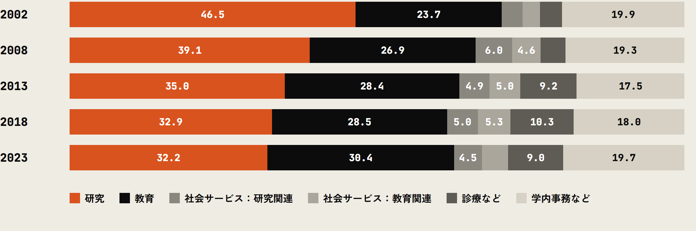

出典：<a href="https://www.mext.go.jp/content/20250418-mxt_chousei01-000040124.pdf">文部科学省「令和5年度 大学等におけるフルタイム換算データに関する調査」概要 図表17</a>

<!--
【ノート】50秒。
文部科学省は、ほぼ 5 年ごとに、大学の教員が職務時間を何に使っているかを調べています。フルタイム換算データに関する調査と呼ばれるものです。
2002 年度、研究に使う時間は職務時間の 46.5% でした。その後、2008 年度に 39.1%、2013 年度に 35.0%、2018 年度に 32.9% と下がり続け、2023 年度は 32.2% です。約 20 年で 14.3 ポイント、割合にして 3 分の 2 ほどになりました。
では、この 14.3 ポイントはどこへ行ったのでしょうか。
-->

---

<!-- _class: t1 dense -->

01

研究時間

## 低下分の行き先

低下した 14.3 ポイントの大半は<em>教育と診療</em>に移った。学内事務の割合は約 2 割のまま、ほとんど変わっていない。

2002 年度から 2023 年度までの割合の増減・ポイント

研究−14.3

教育+6.7

診療など+5.4

社会サービス：教育関連+1.5

社会サービス：研究関連+1.1

学内事務など−0.2

診療などは、附属病院での診療を中心とする社会サービス活動。増減は四捨五入のため合計が 0 にならない

<!--
【ノート】55秒。
14.3 ポイントの行き先を、区分ごとの増減で並べました。
いちばん大きいのは教育で、6.7 ポイント増えています。次が診療などで、5.4 ポイント。これは主に医学部の附属病院での診療です。この 2 つで 12 ポイント、低下分の 8 割以上を占めます。残りは、学外での講演や公開講座のような社会サービスです。
一方、学内事務の割合は約 2 割で、20 年間ほとんど変わっていません。
つまり、研究時間が減ったのは、事務作業が増えたからというより、教育と診療が増えたから、というのが調査の示すところです。
もう一段、分野別に見てみます。
-->

---

<!-- _class: t1 dense -->

01

研究時間

## 分野による違い

低下の多くは、教員の 36.1% を占める保健分野によるもので、理学・工学・農学では 2008 年度以降、研究時間の割合は<em>大きく変わっていない</em>。

分野別の研究時間の割合・2023 年度

理学48.0%

工学38.0%

農学37.6%

人文・社会科学33.3%

保健28.8%

その他25.4%

保健分野は診療などが職務時間の 21.9% を占める。教員数の割合は令和 4 年度の科学技術研究調査による

出典：<a href="https://www.mext.go.jp/content/20250418-mxt_chousei01-000040124.pdf">文部科学省 FTE 調査 概要 図表6・17〜23</a>

<!--
【ノート】55秒。
分野別に見ると、事情はさらにはっきりします。
2023 年度の研究時間の割合は、理学が 48.0% でいちばん高く、保健分野は 28.8% です。保健分野では診療などが職務時間の 21.9% を占めています。そして保健分野の教員は、大学の教員全体の 36.1% にのぼります。
調査報告自身も、全体の研究時間の低下には保健分野の影響が大きく、理学・工学・農学では 2008 年度以降、大きな変化は見られないと書いています。
ですから、「大学の先生は一律に研究時間を奪われている」という見方は正確ではありません。分野によって事情が違います。
では、研究時間を取り戻すのは難しいのでしょうか。
-->

---

<!-- _class: t1 dense -->

01

研究時間

## 研究時間を増やしにくい理由

教員が挙げる研究時間の制約の 1 位は<em>大学運営業務</em>、2 位は教育の負担で、いずれも研究者個人の工夫では減らしにくい。

1 位大学運営業務：教授会などの学内会議と、それに伴う業務

2 位過重な教育負担：教育専任の教員の不足などによる

参考備品購入や出張などの学内事務手続きを挙げた教員は、大学運営業務の半数程度にとどまる

発表者の見方：会議や教育の体制は組織として見直すものであり、個人で変えられる範囲は限られる。個人が変えられるのは、研究時間の使い方である

出典：<a href="https://www.mext.go.jp/content/20250418-mxt_chousei01-000040124.pdf">文部科学省 FTE 調査 概要 図表14</a>

<!--
【ノート】50秒。
同じ調査では、研究のパフォーマンスを高めるうえで何が制約になっているかも聞いています。
研究時間についての制約で最も多いのは、教授会などの学内会議とそれに伴う業務、つまり大学運営業務です。2 番目が、教育専任の教員の不足などによる過重な教育負担です。備品の購入や出張の手続きといった学内事務を挙げた人は、その半分ほどでした。
会議や教育の体制は、組織として見直すべきもので、先生個人ではどうにもなりません。ここからは私の見方ですが、個人が変えられるのは、残った研究時間の使い方のほうです。
では、その研究時間の中身はどうなっているのでしょうか。
-->

---

<!-- _class: t1 dense -->

01

付帯業務

## 研究時間の中の付帯業務

研究費の申請と報告は<em>研究時間の一部</em>として数えられている。5 年間で、申請に 99 時間、報告に 37 時間を使っている。

99<small>時間</small>

5 年間の申請書類の作成 平均 4.5 件

37<small>時間</small>

5 年間の実績報告の作成 平均 2.5 件

研究時間<small>の内数</small>

国際基準のフラスカティ・マニュアルに従い 研究活動として計上

2018〜2022 年度の 5 年間に、競争的研究費などの外部資金の獲得に必要な業務を行った教員の平均

出典：<a href="https://www.mext.go.jp/content/20250418-mxt_chousei01-000040124.pdf">文部科学省 FTE 調査 概要 図表11</a>

<!--
【ノート】55秒。
ここで大事な点があります。研究費の申請書を書く時間や、実績報告を書く時間は、この調査では研究時間の一部として数えられています。研究開発の統計の国際基準であるフラスカティ・マニュアルに従っているためです。
5 年間で、申請に平均 99 時間、報告に平均 37 時間です。年にならすと 30 時間弱ですから、それだけで研究時間が奪われているとは言えません。
ただ、32.2% の研究時間がすべて研究そのものに使われているわけではない、ということは押さえておきたいところです。研究時間の中には、申請や報告、文献の整理やデータの管理のような、研究に付帯する業務が含まれています。
そしてこの付帯業務は、制度によって増えています。
-->

---

<!-- _class: t1 dense -->

01

付帯業務

## 制度で加わった付帯業務

2024 年度以降、データ管理計画の作成と、論文と根拠データの<em>即時公開</em>が、競争的研究費の要件として加わった。

| 制度 | 対象と開始時期 | 研究者に求められること |
|---|---|---|
| データマネジメントプラン | 科研費は 2024 年度以降の全課題 | 研究の開始時に、データの保存・共有・公開の計画を立てる。報告時に、公開したデータの情報を提出する |
| 即時オープンアクセス | 2025 年度から新たに公募する科研費などの競争的研究費 | 論文と根拠データを、学術誌への掲載後すぐに機関リポジトリなどで公開する |

データマネジメントプランは、国の第 6 期科学技術・イノベーション基本計画で、公募型の研究資金の新規公募分での導入率を 2023 年度までに 100% にする目標が掲げられていた

出典：<a href="https://www.jsps.go.jp/j-grantsinaid/01_seido/10_datamanagement/index.html">日本学術振興会 科研費における研究データの管理・利活用</a>・<a href="https://www8.cao.go.jp/cstp/oa_240216.pdf">学術論文等の即時オープンアクセスの実現に向けた基本方針</a>・<a href="https://www8.cao.go.jp/cstp/kihonkeikaku/6honbun.pdf">第6期科学技術・イノベーション基本計画</a>

<!--
【ノート】55秒。
最近、研究費の要件として新たに 2 つの業務が加わりました。
1 つはデータマネジメントプラン、DMP です。研究データをどう保存し、共有し、公開するかの計画です。科研費では 2024 年度以降、新規も継続もすべての課題で、研究を始めるときに計画を立て、報告のときに公開したデータの情報を出すことになりました。
もう 1 つは即時オープンアクセスです。2025 年度から新たに公募する科研費などでは、論文と、その根拠になったデータを、学術誌に載ったらすぐに機関リポジトリなどで公開することが義務になりました。
どちらも研究の価値を高めるための制度ですが、研究者から見れば、研究時間の中で行う付帯業務が増えたことになります。
こうした状況に対して、国はどこに向かおうとしているのでしょうか。
-->

---

<!-- _class: t1 dense -->

01

国の方針

## AI for Science の方針

文部科学省は 2026 年 3 月、<em>研究プロセスの自動化と知能化</em>を、AI for Science の政策目的の第一に掲げた。

「研究プロセスの自動化・知能化により知の生産性を向上させ、研究者がより高次元で創造的な活動に専念できる環境を実現する」── 文部科学省「AI for Science の推進に向けた基本的な戦略方針」政策目的Ⅰ・2026 年 3 月 31 日

同じ方針は、AI が仮説生成・実験設計・解析・知識統合といった研究プロセスのあらゆる段階に関与し始めていると述べ、2030 年代に AI が研究の自然な一部として使われる環境を目指すとしている

出典：<a href="https://www.mext.go.jp/content/20260403-mxt_jyohoka01-000048752_1.pdf">AI for Science の推進に向けた基本的な戦略方針</a>

<!--
【ノート】50秒。
文部科学省は今年 3 月、「AI for Science の推進に向けた基本的な戦略方針」を決めました。
その政策目的の 1 つ目がこれです。「研究プロセスの自動化・知能化により知の生産性を向上させ、研究者がより高次元で創造的な活動に専念できる環境を実現する」。
AI はすでに、仮説を立てる、実験を設計する、解析する、知識をまとめる、といった研究のあらゆる段階に関わり始めている、というのが方針の認識です。そして 2030 年代には、AI が研究の自然な一部として使われる環境を目指すとしています。
先ほどの、研究時間の使い方を変えるという方向と、ぴったり重なります。では、国はどの程度本気なのでしょうか。
-->

---

<!-- _class: t1 dense -->

01

国の方針

## 国の投資と研究者の関心

研究への AI 活用を支える公募には約 1 万 6 千件の応募が集まったが、採択は <em>2.9%</em> にとどまった。

5<small>年間</small>

2026〜2030 年度を集中改革期間とし 研究・計算資源・データに投資する

15,868<small>件</small>

AI を使う研究を支える公募 SPReAD の 第 1 回の応募数

2.9<small>%</small>

同じ公募の採択率 採択は 456 件

発表者の見方：関心を持つ研究者の大半は、公募の支援を受けずに AI を使い始めることになる。研究室の単位で、すぐに使える手段が求められている

出典：<a href="https://www.mext.go.jp/content/20260403-mxt_jyohoka01-000048752_1.pdf">AI for Science の推進に向けた基本的な戦略方針</a>・<a href="https://www.mext.go.jp/content/20260629-mxt_jyohoka01-000050750_1.pdf">AI for Science 推進委員会 第5回 資料1</a>

<!--
【ノート】55秒。
国は 2026 年度から 2030 年度の 5 年間を集中改革期間と位置づけ、研究力、計算資源、データの 3 つの柱に投資します。
その一環として、AI を使った研究を支援する SPReAD という公募が行われました。第 1 回の応募は 1 万 5,868 件。学生からの応募も 2 千件を超えています。研究者の関心がどれだけ高いかが分かります。
ところが、採択されたのは 456 件、採択率は 2.9% です。
ここからは私の見方ですが、関心を持つ研究者の大半は、国の支援を受けずに、自分たちで AI を使い始めることになります。研究室の単位で、すぐに使える手段が求められているということです。
ただし、使い方には決まりがあります。
-->

---

<!-- _class: t1 dense -->

01

利用の決まり

## 生成 AI 利用の決まり

科研費は生成 AI の利用を禁じていないが、利用の判断と<em>責任は研究者個人</em>にあるとしている。

| 立場 | 定められていること |
|---|---|
| 応募する研究者 | 著作権の侵害や個人情報・機密情報の漏えいのリスクがあるため、生成 AI を使うかは研究者個人の責任で判断する |
| 審査する委員 | 研究計画調書などの審査資料を、生成 AI に入力してはならない |
| 制度を検討する部会 | 生成 AI で研究計画の作成が省力化され、応募が増えて審査を圧迫する可能性が指摘されている |

出典：<a href="https://www.jsps.go.jp/file/storage/kaken_kiban_2026_g_4978/r9_7_kobo.pdf">令和9年度 科学研究費助成事業 公募要領</a>・<a href="https://www.mext.go.jp/content/20260602-mxt_gakjokik-000050033_1.pdf">科学技術・学術審議会 研究費部会 資料</a>

<!--
【ノート】50秒。
令和 9 年度の科研費の公募要領には、生成 AI についての記載があります。
応募する研究者に対しては、著作権の侵害や、個人情報・機密情報の漏えいにつながるリスクがあるので、使うかどうかは研究者個人の責任で判断してください、としています。禁止ではありません。
審査する委員に対しては、研究計画調書を生成 AI に入力してはいけない、と明確に禁じています。
また、制度を検討している研究費部会では、生成 AI で計画書づくりが楽になり、応募が増えて審査を圧迫するのではないか、という懸念も出ています。
つまり、AI を使うこと自体は認められていますが、出てきたものを人が確かめ、責任を持つことが前提です。ここまでをまとめます。
-->

---

<!-- _class: t1 -->

01

背景

研究時間の量は増やしにくい。 付帯業務を AI に任せ、 研究者は問いと判断に集中する。

| 観点 | 事実 | 意味すること |
|---|---|---|
| 研究時間 | 約 20 年で 46.5% から 32.2% に。主に教育と診療へ | 研究者個人では取り戻しにくい |
| 付帯業務 | 申請と報告に加え、DMP と即時公開が要件になった | 研究時間の中で、研究以外の作業が増えている |
| 国の方針 | 研究プロセスの自動化を政策目的の第一に掲げた | AI の研究利用は国の方向と一致する |
| 利用の決まり | 生成 AI の利用は研究者個人の責任で判断する | AI の出力を人が確かめる手順が必要になる |

<!--
【ノート】40秒。
背景をまとめます。研究時間の量を増やすのは難しい。だから、研究時間の中の付帯業務を AI に任せ、研究者は問いを立てることと判断することに集中する。これが今日の提案です。
根拠は 4 つです。研究時間は教育と診療に移っていて、個人では取り戻しにくい。研究時間の中では付帯業務が制度で増えている。国も研究プロセスの自動化を目指している。そして、AI の利用は認められているが、責任は研究者にある。
では、研究のどこを AI に任せ、どこを人が担うのか。次のトラックで整理します。
-->

---

<!-- _class: t2 dark eye -->

02

### Framework

研究プロセスと AI の分担

<!--
【ノート】10秒。
2 つ目のトラックでは、研究プロセスを分解して、AI に任せる部分と人が担う部分を整理します。ここでは、まだ特定の製品の話はしません。
-->

---

<!-- _class: t2 dense -->

02

研究プロセス

## 研究プロセスの 5 フェーズ

研究は課題設定から成果発信までの 5 つのフェーズを繰り返し、各フェーズで<em>付帯業務が発生する</em>。

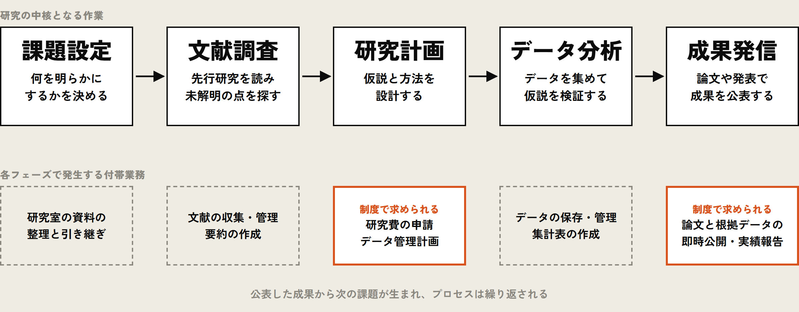

<!--
【ノート】55秒。
研究のプロセスを、5 つのフェーズに分けて考えます。
何を明らかにするかを決める課題設定。先行研究を読んで、まだ分かっていない点を探す文献調査。仮説と方法を設計する研究計画。データを集めて仮説を検証するデータ分析。そして、論文や発表で成果を公表する成果発信です。公表した成果から次の課題が生まれ、プロセスは繰り返されます。
上の段が研究の中核となる作業だとすると、下の段は、各フェーズで発生する付帯業務です。資料の整理と引き継ぎ、文献の管理と要約、研究費の申請とデータ管理計画、データの保存と集計表の作成、論文と根拠データの公開と実績報告。オレンジの 2 つは、先ほど見た制度で求められるものです。
この 5 つのフェーズで、AI と人はどう分担すればよいでしょうか。
-->

---

<!-- _class: t2 dense -->

02

分担

## AI と人の分担

AI には調査・整理・下書き・計算を任せ、<em>課題の選択と結果の解釈</em>、そして最終的な責任は人が担う。

| フェーズ | AI に任せる作業 | 人が判断すること |
|---|---|---|
| 課題設定 | 研究室の資料と文献から、研究課題の候補を挙げて比較する | どの課題に取り組むか |
| 文献調査 | 先行研究を集め、出典つきで要約する | 引用が正しいか |
| 研究計画 | 研究計画とデータ管理計画の下書きを作成する | 方法・データの公開範囲・倫理面の妥当性 |
| データ分析 | コードを書いてデータを集計する | 結果の解釈と検算 |
| 成果発信 | 読み手に合わせて文章を書き分ける | 何を主張するか |

<!--
【ノート】55秒。
分担の考え方はシンプルです。AI には、調べる、整理する、下書きする、計算する、を任せます。人は、どの課題を選ぶか、結果をどう解釈するかを判断し、最終的な責任を持ちます。
課題設定なら、AI が候補を挙げて比較し、人がどれに取り組むかを決めます。文献調査なら、AI が要約し、人が引用の正しさを確かめます。研究計画なら、AI が下書きを作り、データをどこまで公開するか、倫理的に問題がないかは人が判断します。データ分析なら、AI が集計し、人が解釈して検算します。成果発信なら、AI が書き分け、何を主張するかは人が決めます。
この分担を実現するには、AI にどんな能力が必要でしょうか。
-->

---

<!-- _class: t2 dense -->

02

求められる能力

## AI に求められる 4 つの能力

この分担には 4 つの能力が要る。一般的な AI チャットには、<em>研究室の資料の参照</em>と、手順を繰り返し実行する仕組みが欠けている。

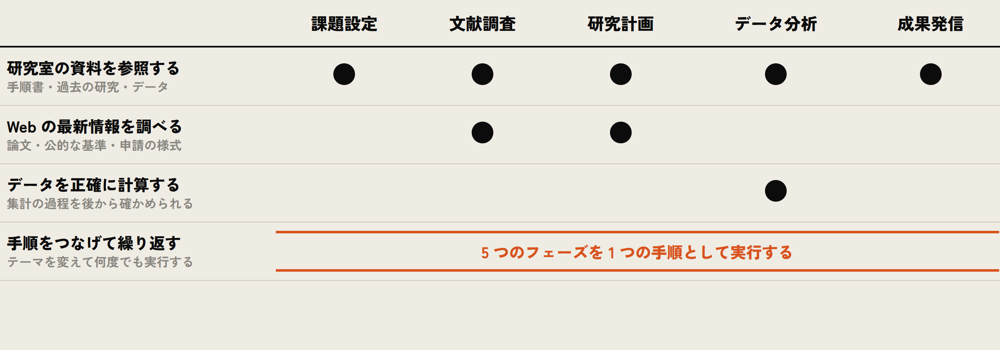

<!--
【ノート】55秒。
各フェーズで AI に求められる能力を、表にまとめました。
1 つ目は、研究室の資料を参照する能力です。手順書、過去の研究、手元のデータを踏まえて答えられないと、一般論しか返ってきません。これは全フェーズで必要です。
2 つ目は、Web の最新情報を調べる能力です。論文や公的な基準、申請書の様式などで、文献調査と研究計画で必要です。
3 つ目は、データを正確に計算する能力です。AI が数字を読んで答えるのではなく、計算の過程を後から確かめられる形で計算することが大切です。
4 つ目は、手順をつなげて繰り返す能力です。テーマを変えて、5 つのフェーズを何度でも同じように回せることです。
実際に一般的な AI チャットで研究室の手順を質問すると、一般論が返ってきました。研究室の資料を知らないからです。では、この 4 つの能力を持つサービスとして、AWS Quick を紹介します。
-->

---

<!-- _class: t3 dark eye -->

03

### Product

AWS Quick の概要

<!--
【ノート】10秒。
3 つ目のトラックでは、AWS Quick がどんなサービスで、どう使うのかを、実際の画面で順に紹介します。
-->

---

<!-- _class: t3 dense -->

03

AWS Quick

## AWS Quick とは

AWS Quick は、調査・分析・作業の自動化を <em>AI エージェント</em>に任せる、ブラウザで使う業務向けのサービスである。

提供元AWS。2026 年 11 月 9 日に Amazon Quick から改称された

使い方ブラウザで操作する。プログラミングは不要で、指示はすべて文章で書く

主な機能資料をまとめる Space、質問に答えるチャットエージェント、調査を行う Research、手順を自動化する Flows、データを可視化する Quick Sight

利用者個人で使うプランと、組織で契約して AWS のデータに接続するプランがある

出典：<a href="https://docs.aws.amazon.com/quick/latest/userguide/what-is.html">What is AWS Quick｜AWS Quick ユーザーガイド</a>・<a href="https://aws.amazon.com/about-aws/whats-new/2026/11/amazon-quick-aws-quick/">Amazon Quick is now AWS Quick</a>

<!--
【ノート】50秒。
AWS Quick は、AWS が提供する業務向けの AI サービスです。調べ物、データの分析、定型作業の自動化などを、AI エージェントに任せることができます。つい先日、11 月 9 日に Amazon Quick から AWS Quick に名前が変わりました。
使うのはブラウザだけで、プログラミングは要りません。AI への指示は、すべて普通の文章で書きます。
主な機能は 5 つです。資料をまとめる Space、質問に答えるチャットエージェント、調査を行う Research、手順を自動化する Flows、それにデータを可視化する Quick Sight です。今日は前の 4 つを使います。
では、AWS の AI サービス全体の中で、Quick はどこに位置するのでしょうか。
-->

---

<!-- _class: t3 dense -->

03

AWS Quick

## AWS の生成 AI での位置付け

AWS の生成 AI は 3 層で構成され、AWS Quick は開発をせずに<em>すぐ使える最上段</em>にあたる。

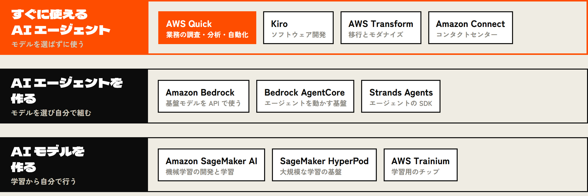

出典：<a href="https://docs.aws.amazon.com/decision-guides/latest/decision-guides/genai-guide.html">Choosing a generative AI service｜AWS Decision Guide</a>・<a href="https://aws.amazon.com/jp/blogs/news/aws-jpps-seminar-2026-april/">AWS 公共セミナー 2026 開催報告</a>

<!--
【ノート】50秒。
AWS は、生成 AI のサービスを 3 つの層で説明しています。
いちばん下は、AI のモデルそのものを作る層で、SageMaker AI や、学習用のチップの Trainium などです。真ん中は、AI エージェントを自分で作る層で、さまざまな基盤モデルを API で使える Amazon Bedrock や、エージェントを動かす基盤の AgentCore があります。
いちばん上が、開発をせずにすぐ使える AI エージェントの層です。開発向けの Kiro、コンタクトセンター向けの Connect と並んで、AWS Quick がここに入ります。
研究室で使うなら、システムを開発しなくても、研究者や事務の担当者がすぐに使い始められる、というのが Quick の位置付けです。
では、どうやって始めるのかを見ていきます。
-->

---

<!-- _class: t3 dense -->

03

始め方

## 始め方

個人向けのプランはメールアドレスで登録でき、AWS アカウントは不要である。新しいアカウントは <em>30 日間無料</em>で試せる。

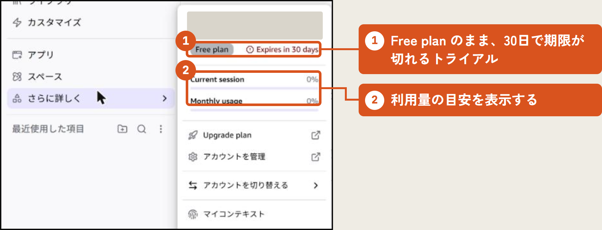

<!--
【ノート】40秒。
個人やチーム向けのプランは、メールアドレスや Google アカウントで登録できます。AWS のアカウントを作る必要はありません。
新しくアカウントを作ると、有料の Plus プランを 30 日間無料で試せます。私もこの無料トライアルで、クレジットカードを登録せずに今日の内容をすべて実施しました。
画面には、利用量の目安も表示されます。
登録すると、次のような画面になります。
-->

---

<!-- _class: t3 dense -->

03

画面の構成

## 画面の構成

左のメニューの<em>チャット・カスタマイズ・スペース・研究</em>の 4 つを入口に使う。

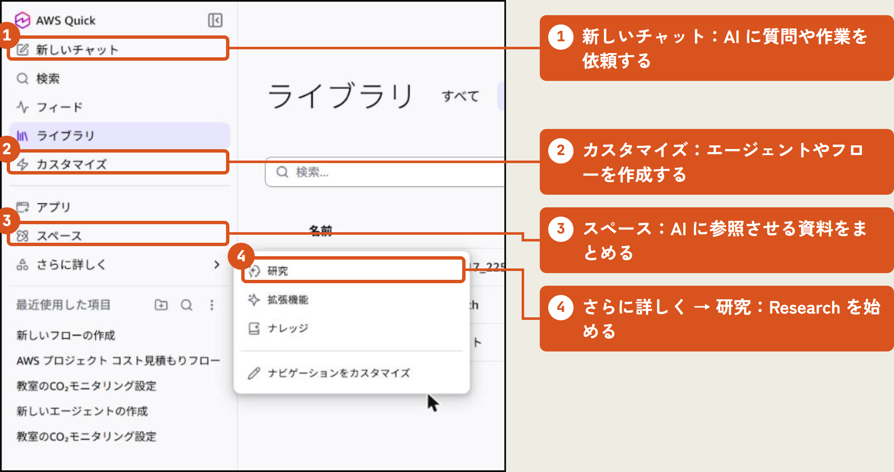

<!--
【ノート】45秒。
これが AWS Quick の画面です。左のメニューのうち、今日使うのは 4 つです。
1 つ目の新しいチャットは、AI に質問したり作業を頼んだりする場所です。2 つ目のカスタマイズでは、自分用のエージェントやフローを作ります。3 つ目のスペースは、AI に参照させる資料をまとめる場所です。そして、さらに詳しくの中の研究から、Research という調査の機能を始めます。
まずはスペースから順に見ていきます。
-->

---

<!-- _class: t3 dense -->

03

Space

## Space の作成

Space は、AI に参照させたい資料をまとめる場所で、<em>名前と説明</em>を付けて作成する。

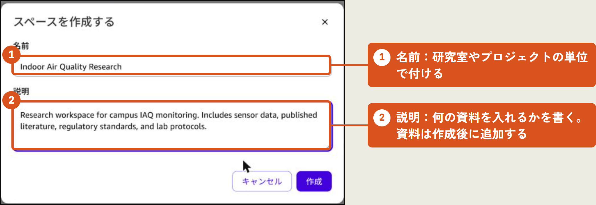

<!--
【ノート】35秒。
Space は、AI に参照させたい資料をまとめておく場所です。研究室やプロジェクトごとに 1 つ作るイメージです。
作成するときは、名前と説明を入れるだけです。今回は、教育施設の室内の空気質を研究する研究室を想定して、Indoor Air Quality Research という名前にしました。資料は、作成したあとに追加します。
-->

---

<!-- _class: t3 dense -->

03

Space

## 資料の追加

資料を追加すると数十秒で検索できる状態になる。今回は<em>研究室の資料 5 点</em>を入れた。

<!--
【ノート】45秒。
Space に資料をアップロードすると、数十秒で準備完了になり、AI が中身を検索できる状態になります。
今回入れたのは 5 点です。センサーの設置と校正の手順書、室内の空気と認知機能についての文献レビュー、アメリカ環境保護庁と ASHRAE という学会の基準の要約、そして教育施設 3 棟、9 か所のセンサーで測った 1 か月分のデータです。PDF、Word、Markdown、CSV と、形式はばらばらでかまいません。
この資料を踏まえて答える AI を作るのが、次のチャットエージェントです。
-->

---

<!-- _class: t3 dense -->

03

チャットエージェント

## チャットエージェントの作成

チャットエージェントは、<em>役割と回答の進め方</em>を文章で指示し、Space を紐づけて作成する。

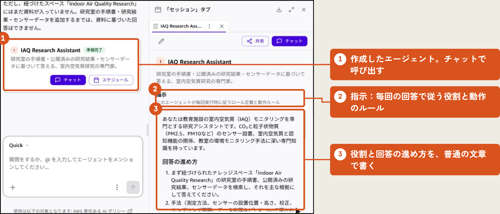

<!--
【ノート】50秒。
チャットエージェントは、特定の役割を持たせた AI です。カスタマイズのエージェントのタブから作るか、チャットで「こういうエージェントを作って」と頼んで作ります。
画面の右側が、作成したエージェントの設定です。指示の欄に、役割と回答の進め方を普通の文章で書きます。今回は「あなたは教育施設の室内空気質の研究アシスタントです。まず紐づけた Space の手順書や研究結果を検索し、それを根拠に答えてください。手法について聞かれたら、必ず研究室の手順書を確認してから答えてください」といった内容にしました。
では、一般的な AI と答えがどう変わるかを見てみます。
-->

---

<!-- _class: t3 dense -->

03

チャットエージェント

## 一般的な AI との違い

同じ質問に、一般的な AI は一般論で答えたが、作成したエージェントは<em>研究室の手順書の節</em>を示して答えた。

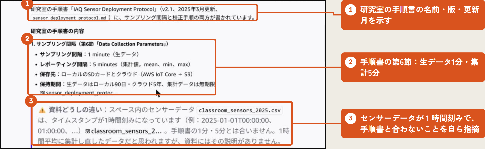

<!--
【ノート】50秒。
「教室で CO₂ を連続で測るとき、推奨されるサンプリング間隔と、センサーの校正の手順は」と聞きました。
エージェントを使わない一般的な AI は、目的別に 1 分から 10 分といった一般論を答え、「機種名を教えていただければ」と続けました。研究室の手順を知らないからです。
作成したエージェントは、研究室の手順書の名前と版を示し、「第 6 節によると、生データは 1 分間隔、集計は 5 分間隔」と答えました。さらに、センサーデータが 1 時間刻みで、手順書と合わないことを自分から指摘しています。
研究室の新しいメンバーが手順を確認する場面などで、そのまま役立ちそうです。裏側で何が起きていたかを見てみます。
-->

---

<!-- _class: t3 dense -->

03

チャットエージェント

## 回答までの処理

日本語の検索語では資料が見つからず、<em>英語に言い換えて検索し直し</em>、手順書を出典に答えた。

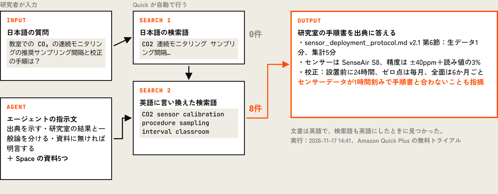

<!--
【ノート】45秒。
エージェントが回答するまでの処理を、画面の記録から図にしました。
入力は、日本語の質問と、エージェントへの指示と、Space の資料です。エージェントはまず日本語のまま資料を検索しましたが、0 件でした。資料が英語だからです。
すると自分で検索語を英語に言い換えて検索し直し、8 件を見つけました。そのうち手順書を出典にして、日本語で答えています。
英語の論文や海外の手順書をそのまま Space に入れても、日本語で質問できるということです。
もう 1 つ、資料にないことを聞いたらどうなるかを試しました。
-->

---

<!-- _class: t3 dense -->

03

チャットエージェント

## 資料にない情報への対応

資料にない数値を聞くと、推測の値を示さず、<em>資料に情報がない</em>と答えた。

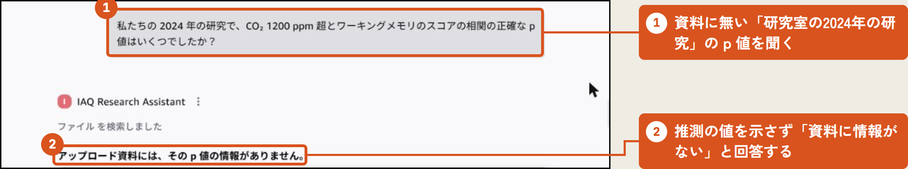

<!--
【ノート】35秒。
「私たちの 2024 年の研究で、CO₂ が 1200ppm を超えたときのワーキングメモリとの相関の p 値は」と、資料に書かれていないことを聞きました。
エージェントは、それらしい数字を作らずに、「アップロードされた資料には、その情報がありません」と答えました。研究で使ううえでは、知らないことを知らないと言えるのは大事な性質です。
次は、調査を行う Research です。
-->

---

<!-- _class: t3 dense -->

03

Research

## Research の設定

Research は、調査の目的を文章で書き、<em>Web と Space の資料</em>を対象に調査させる機能である。

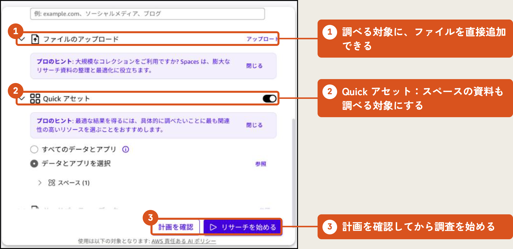

<!--
【ノート】45秒。
Research は、ある程度まとまった調査を任せる機能です。メニューのさらに詳しくから、研究を選んで始めます。
画面の左で、調べる対象を選びます。Web 検索に加えて、ファイルを直接追加したり、Quick アセットとして Space の資料を対象に含めたりできます。
目的の欄には、調査の背景と知りたいことを数行の文章で書きます。今回は、教室の CO₂ 濃度と認知機能の関係について、研究デザイン、しきい値、交絡因子、未解明の点などを調べるよう頼みました。
いきなり始めずに、計画を確認するボタンで、AI が立てた調査計画を見て修正してから始めることもできます。
-->

---

<!-- _class: t3 dense -->

03

Research

## Research の実行

<em>5 つの調査を並行</em>して進め、約 10 分で出典つきの報告書にまとめた。

<!--
【ノート】40秒。
始めると、進み具合がパーセントで表示されます。この調査では、5 つの調査を並行して進め、47 件の研究の知見をまとめていました。出典として、PubMed などの論文を集めています。
約 10 分で、エグゼクティブサマリー、研究デザインの比較、しきい値、交絡因子、研究の空白、結論という構成の報告書ができました。研究室の文献レビューも参考文献の 1 つとして使われています。
報告書には図も含まれます。
-->

---

<!-- _class: t3 dense -->

03

Research

## 報告書の図と注意点

報告書には各国の基準を比べる図も含まれたが、<em>数値と主張は原典での確認</em>が必要である。

<!--
【ノート】45秒。
私が「日本の学校の基準とも比べてほしい」と計画に追加したところ、各国の基準値と、認知への影響が出始める濃度を比べる図を描きました。
日本の学校環境衛生基準の 1500ppm を「最も緩い」と位置付け、「見直しの余地がある」とまで書いています。ただ、これは AI の主張です。日本の基準は 1500ppm 以下が「望ましい」とするもので、AI は「定めている」と書いていました。こうした細かいずれがあるので、報告書の数値と主張は、原典で確かめる必要があります。
次は、数値の計算です。
-->

---

<!-- _class: t3 dense -->

03

コード実行

## データの集計

数値の集計を頼むと、AI が <em>Python のコードを書いて実行</em>し、その結果を表で返す。

<!--
【ノート】40秒。
チャットで「建物ごとに CO₂ の平均と最大を出して、1000ppm を超えた時間がどこに多いかも教えて」と頼みました。
返ってきたのが、この表です。建物ごとの平均と最大、そして 1000ppm を超えたのは全体で 30 時間、そのうち 27 時間が ENG-B という建物の実験室だった、という結果です。
この数字は、AI が CSV を目で読んで答えたものではありません。
-->

---

<!-- _class: t3 dense -->

03

コード実行

## 集計のコード

実行したコードは<em>成果物として残る</em>ため、計算の過程を後から確かめられる。

<!--
【ノート】40秒。
裏側では、AI が Python の pandas というライブラリでコードを書き、実行しています。CSV を読み込み、建物ごとに平均、最大、件数を出し、1000ppm を超えた行を数えるコードです。
このコードは成果物として残るので、どう計算したのかを人が後から確かめられます。研究で使ううえでは、計算の再現性が確かめられることが重要です。私も手元で同じ計算をして、結果が一致することを確かめました。
最後の機能が、手順を自動化する Flows です。
-->

---

<!-- _class: t3 dense -->

03

Flows

## Flows の構成

Flows は、AI エージェントと決まった処理を<em>ステップとしてつなぎ</em>、同じ手順を何度でも実行できるようにする機能である。

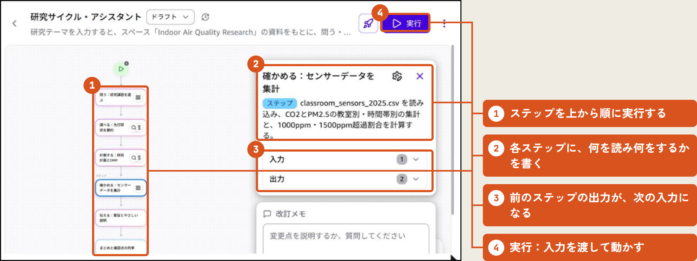

<!--
【ノート】50秒。
Flows は、いくつかのステップを順番につないだ手順書のようなものです。カスタマイズのフローのタブから作るか、チャットで「こういうフローを作って」と頼んで作ります。
画面の左側に、ステップが上から順に並んでいます。各ステップには、何を読み、何をするかが書かれています。このステップは、センサーデータを読み込んで、時間帯別の集計をするという内容です。前のステップの出力が、次のステップの入力になります。
右上の実行ボタンを押すと、入力欄が出て、そこに値を入れると最後まで自動で進みます。
ステップの種類と、うまくいかないときの動きをまとめます。
-->

---

<!-- _class: t3 dense -->

03

Flows

## Flows の特徴と限界

判断が要るステップは AI エージェントが担い、実行に失敗すると、<em>Quick が原因を説明してフローを修正</em>する。

ステップ判断が要るステップは AI エージェントが、集計や結合は決まった処理が担う

道具AI エージェントのステップは、Web 検索や資料の検索を使える

修正実行に失敗すると、Quick が原因を説明してフローを書き換える。変更は履歴に残り、元に戻せる

限界表をスクリプトで表示する Web ページは読み取れない。AWS の料金ページの単価は取得できなかった

<!--
【ノート】50秒。
フローのステップには 2 種類あります。課題を選ぶ、計画を書く、といった判断が要るステップは AI エージェントになり、集計やまとめのような決まった処理は、処理のステップになります。
AI エージェントのステップは、Web 検索や資料の検索といった道具を使えます。
実行に失敗すると、Quick が原因を説明し、フローを書き換えて再実行します。書き換えは履歴に残り、元に戻すこともできます。
限界もあります。費用の見積もりのフローを試したところ、AWS の料金ページが表をスクリプトで表示する作りのため、単価を読み取れず、AI が記憶している値を使ったと自分で報告してきました。
ここまでの 4 つの機能を、前のトラックの 4 つの能力と対応させます。
-->

---

<!-- _class: t3 dense -->

03

AWS Quick

## 能力と機能の対応

研究プロセスの分担に必要な 4 つの能力は、AWS Quick の <em>4 つの機能</em>でそろう。

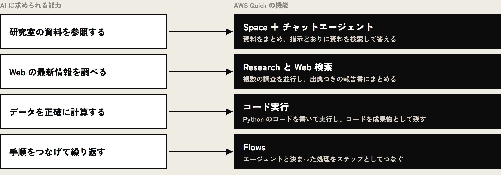

<!--
【ノート】45秒。
前のトラックで、AI に求められる能力を 4 つ挙げました。
研究室の資料を参照する能力は、Space とチャットエージェントで満たせます。Web の最新情報を調べる能力は、Research と Web 検索の道具で。データを正確に計算する能力は、コード実行で。そして手順をつなげて繰り返す能力は、Flows で満たせます。
道具はそろいました。次のトラックでは、これらを組み合わせて、研究プロセスを実際に一巡させてみます。
-->

---

<!-- _class: t4 dark eye -->

04

### Practice

研究プロセスを AWS Quick で一巡させる

<!--
【ノート】10秒。
4 つ目のトラックは実践です。研究プロセスの 5 フェーズを、AWS Quick で実際に一巡させました。
-->

---

<!-- _class: t4 dense -->

04

全体像

## 実践の全体像

5 つのフェーズを <em>1 本のフロー</em>にまとめ、研究テーマを入力するだけで一巡する構成にした。

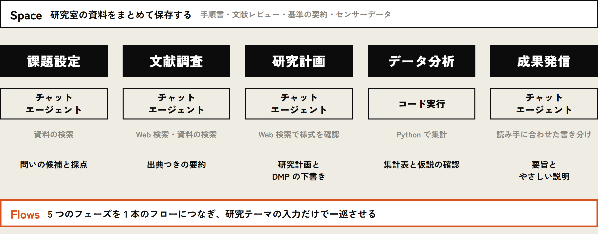

<!--
【ノート】50秒。
作ったものの全体像です。
土台は、研究室の資料 5 点を入れた Space です。その上で、課題設定、文献調査、研究計画、成果発信の 4 つは AI エージェントのステップにし、資料と Web を調べながら、候補、要約、計画の下書き、説明文を作らせます。データ分析だけは、決まった集計の処理のステップです。
そして、この 5 つを Flows の 1 本のフローにつなぎました。研究テーマを 1 つ入れるだけで、課題の候補から成果の説明文までが出てくる、という設計です。
では、どう準備したかから見ていきます。
-->

---

<!-- _class: t4 dense -->

04

準備

## 準備した資料と依頼文

研究室の資料 5 点を Space に入れ、フローの内容は<em>日本語の依頼文 1 つ</em>で指示した。

| 資料 | 内容 |
|---|---|
| 手順書 | センサーの設置・校正の手順 |
| 文献レビュー | CO₂ と認知機能の先行研究 |
| 基準の要約 2 点 | 米国の環境保護庁と ASHRAE |
| センサーデータ | 3 棟 9 か所・1 か月分 |

研究テーマを入力すると、スペースの資料をもとに、問う・調べる・計画する・確かめる・伝えるの 5 段階で研究を一巡させるフローを作って。計画では日本学術振興会の DMP の項目に沿った下書きも作り、最後に人が確認すべき点を並べて

依頼文は要約。資料は AWS 公式の研究者向けハンズオンのサンプルを使った

<!--
【ノート】45秒。
準備はこれだけです。研究室の資料 5 点を Space に入れ、Flows に日本語でこう頼みました。
「研究テーマを入力すると、スペースの資料をもとに、問う、調べる、計画する、確かめる、伝えるの 5 段階で研究を一巡させるフローを作って。計画では、日本学術振興会の DMP の項目に沿った下書きも作り、最後に人が確認すべき点を並べて」。
なお、資料は AWS が公開している研究者向けのハンズオンのサンプルを使っています。架空の研究室の資料です。
-->

---

<!-- _class: t4 dense -->

04

準備

## 作成されたフロー

依頼文から、<em>6 つのステップ</em>のフローが約 1 分で作成された。

<!--
【ノート】45秒。
約 1 分で、6 つのステップのフローができました。依頼文で使った言葉のまま、問う、調べる、計画する、確かめる、伝える、そして最後のまとめと確認点、という名前になっています。
調べると計画するのステップは、Web 検索を道具に使う設定になりました。確かめる、つまりデータ分析のステップは、AI ではなく、決まった集計を行う処理のステップとして作られています。
研究テーマに「教室の CO₂ 濃度と学生の認知機能」と入れて実行しました。最初のフェーズ、課題設定の結果から見ていきます。
-->

---

<!-- _class: t4 dense -->

04

課題設定

## 課題設定

研究プロセス：課題設定文献調査研究計画データ分析成果発信

文献と手元のデータを照らして研究課題の候補を 3 つ挙げ、<em>新規性と実現可能性</em>を採点して 1 つを選んだ。

| 研究課題の候補 | 新規性 | 実現可能性 | AI の判断 |
|---|---|---|---|
| 教室で 1000ppm を超える時間の長さと時間帯を、建物の用途ごとに調べる | 2 | 5 | 実態調査にとどまる |
| CO₂ が高い時間帯に、PM2.5・温度・湿度も同時に上がるかを調べる | 4 | 4 | 採用：合計点が最も高い |
| CO₂ にさらされた時間の累積が、試験の成績を下げるかを調べる | 5 | 2 | 認知機能のデータが手元にない |

<!--
【ノート】55秒。
課題設定では、AI が文献レビューと手元のセンサーデータを照らし合わせて、研究課題の候補を 3 つ挙げました。それぞれ新規性と実現可能性を 5 段階で採点しています。
1 つ目は実態調査で、すぐにできますが新しさは低い。3 つ目はいちばん新しいものの、認知機能のデータが手元にないので今は検証できない。そこで 2 つ目、CO₂ が高い時間帯に、PM2.5 や温度、湿度も同時に上がっているかを調べる課題を選びました。
もし同時に上がっているなら、これまで CO₂ の影響とされてきた認知機能の低下に、ほかの要因が混ざっている可能性がある、という問いです。統計の言葉でいう交絡です。
人が判断するのは、この選び方に納得できるかどうかです。次は文献調査です。
-->

---

<!-- _class: t4 dense -->

04

文献調査

## 文献調査

研究プロセス：課題設定文献調査研究計画データ分析成果発信

先行研究を出典つきで要約したうえで、<em>研究室の資料の引用のうち確認できないもの</em>を指摘した。

| 研究室の文献レビューの記述 | AI が Web で確認した結果 |
|---|---|
| Du et al. 2020 はメタ分析で、1000ppm 超で有意に低下する | 該当する論文は「結果は一貫しない」とするレビューだった |
| Zhang et al. 2022 では、教室で試験の成績が 12% 高い | 論文の存在を確認できなかった |
| ASHRAE の基準は、屋外の濃度より何 ppm 高いか | 資料によって 1000ppm と 700ppm の 2 通りがある |

文献レビューはハンズオン用のサンプルで、架空の引用を含む可能性がある。表は AI の指摘で、発表者は論文を確認していない

<!--
【ノート】55秒。
文献調査では、選んだ課題の先行研究を、Web と研究室の資料から集めて要約しました。主張ごとに出典を付けるよう指示しています。
印象的だったのは、研究室の資料そのものへの指摘です。文献レビューでメタ分析とされていた論文は、Web で見つかったものは「結果は一貫しない」とするレビューでした。教室で成績が 12% 高かったという論文は、存在を確認できなかったそうです。ASHRAE の基準値も、資料によって書き方が違っていました。
この文献レビューはサンプルなので、架空の引用が混ざっていても不思議ではありません。ただ、研究室で引き継がれてきた資料をそのまま信じず、Web と照らして疑ってくれるのは、文献調査を任せる大きな価値です。
次は研究計画です。
-->

---

<!-- _class: t4 dense -->

04

研究計画

## 研究計画

研究プロセス：課題設定文献調査研究計画データ分析成果発信

5 つの仮説を立て、それぞれに<em>判定の基準</em>を付けたが、データの前提は実際と異なっていた。

| 項目 | AI が作成した内容 |
|---|---|
| 研究課題 | CO₂ が高い時間帯に、PM2.5・TVOC・温度・湿度も同時に上がるかを調べる |
| 仮説の例 | CO₂ と PM2.5 の順位相関が 0.3 以上になる。仮説は計 5 つ |
| 方法 | 在室の時間帯と在室しない時間帯に分けて相関を比べ、混合効果モデルで建物の違いを考慮する |
| 前提の誤り | データを 30 教室・1 分値としたが、実際は 9 か所・1 時間値で、TVOC の列もない |

<!--
【ノート】55秒。
研究計画では、選んだ課題に対して 5 つの仮説を立てました。たとえば「CO₂ と PM2.5 の順位相関が 0.3 以上になる」のように、それぞれ判定の基準が付いています。方法も、人がいる時間帯といない時間帯に分けて比べる、建物の違いを統計モデルで考慮する、と具体的です。
ところが、データの前提が違っていました。計画ではデータを「30 教室の 1 分値」としていますが、実際のデータは 9 か所の 1 時間ごとの値で、TVOC という化学物質の列もありません。
原因は、計画のステップが手順書と CSV を読めず、私の依頼文の書きぶりから推測して書いたことでした。この食い違いは、最後に AI 自身も指摘しています。
計画のステップでは、データ管理計画の下書きも作りました。
-->

---

<!-- _class: t4 dense -->

04

研究計画

## データ管理計画の下書き

研究プロセス：課題設定文献調査研究計画データ分析成果発信

日本学術振興会の項目に沿って下書きし、<em>人が決めるべき箇所</em>は埋めずに印を付けて残した。

<!--
【ノート】55秒。
データ管理計画、DMP の下書きです。日本学術振興会の記載項目を Web で確認したうえで作っています。
良かったのは、決まっていないことを勝手に埋めない点です。研究課題の番号や代表者は未記入のまま。データの保存期間は「研究終了後 10 年以上、ただし機関の規程を要確認」、生データを公開するかは「学校の同意次第で要判断」、在室状況が個人情報に当たるかも「要判断」と、人が決める箇所に印を付けています。最新の様式と照らすようにという注記も、自ら入れていました。
一方、③のように、データの前提はここでも「30 教室・1 分値」のままです。
DMP は書式が決まっているぶん、AI に下書きを任せやすい付帯業務だと感じました。次はデータ分析です。
-->

---

<!-- _class: t4 dense -->

04

データ分析

## データ分析

研究プロセス：課題設定文献調査研究計画データ分析成果発信

センサーデータ 6,480 行を集計し、CO₂ と PM2.5 の相関は 0.41 と、<em>仮説の基準 0.3</em> を上回った。

552<small>ppm</small>

CO₂ の平均 最大は 1,205ppm

0.5<small>%</small>

1000ppm を超えた時間の割合 大半は 1 つの実験室

約 660

8〜18 時の平均 ppm 夜間は約 460ppm

0.41

CO₂ と PM2.5 の相関係数 仮説の基準は 0.3 以上

AI は「相関の種類と信頼区間はまだ確認していない」と、分析の限界を自ら書いていた

<!--
【ノート】50秒。
データ分析では、センサーデータ 6,480 行を集計しました。
CO₂ の平均は 552ppm、最大は 1,205ppm です。1000ppm を超えたのは全体の 0.5% で、その大半は 1 つの実験室でした。授業のある 8 時から 18 時は 660ppm 前後、夜は 460 前後で、人がいると上がることがはっきり出ています。
仮説に関わる CO₂ と PM2.5 の相関係数は 0.41 で、仮説の基準の 0.3 を上回りました。ただし AI は、「相関の種類と信頼区間はまだ確認していない」と、分析の限界を自分で書いていました。
この数字が正しいかどうかを、私が手元で確かめました。
-->

---

<!-- _class: t4 dense -->

04

データ分析

## 集計結果の検算

研究プロセス：課題設定文献調査研究計画データ分析成果発信

同じデータを手元の Python で集計し直し、AI の集計値が<em>すべて一致</em>することを確かめた。

| 項目 | AI の集計値 | 発表者の検算 |
|---|---|---|
| CO₂ の平均・中央値・最大 | 552・481・1,205ppm | 551.7・481・1,205ppm |
| 1000ppm を超えた時間の割合 | 0.5%。実験室は 3.8% | 0.46%。実験室は 3.75% |
| 時間帯別の平均 | 8〜18 時は 653〜675ppm・夜間は約 460ppm | 8〜18 時は 653〜675ppm・0〜5 時は 459〜462ppm |
| CO₂ と PM2.5 の相関係数 | 0.41 | 0.406 |

<!--
【ノート】45秒。
AI の集計値を、同じ CSV を使って手元の Python で計算し直しました。
平均、中央値、最大、1000ppm を超えた割合、時間帯別の平均、相関係数。いずれも、四捨五入の違いを除いてすべて一致しました。
データ分析のステップは、AI が文章を読むのではなく、決まった処理としてコードで計算しているので、計算そのものは信頼できます。人がすべきなのは、計算の前提、つまりどのデータをどう集計するかが正しいかを確かめることです。
最後のフェーズ、成果発信です。
-->

---

<!-- _class: t4 dense -->

04

成果発信

## 成果発信

研究プロセス：課題設定文献調査研究計画データ分析成果発信

同じ結果から、研究室向けの要旨と、<em>学校の先生向けの説明</em>を書き分けた。

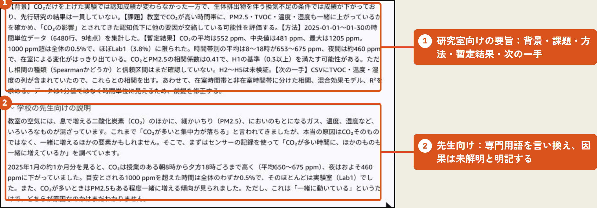

<!--
【ノート】50秒。
成果発信では、同じ結果から 2 種類の文章を書きました。
1 つは研究室の週例ミーティング用の要旨で、背景、課題、方法、暫定結果、次の一手の順にまとまっています。
もう 1 つは、学校の先生向けの説明です。PM2.5 を「細かいちり」と言い換え、「CO₂ が多いときは PM2.5 も一緒に増える傾向があるが、一緒に動いているというだけで、どちらが原因かはまだ分からない」と、言い過ぎないように書いていました。教室でできる換気の工夫も添えています。
研究の成果を、研究に協力してくれた学校に分かりやすく返すところまで、1 つの流れで書けます。
ここまでは 2 回目の実行の結果です。実は 1 回目は失敗していました。
-->

---

<!-- _class: t4 dense -->

04

実行の記録

## 失敗と自己修正

1 回目の実行はデータ分析で停止したが、Quick は<em>原因を説明してフローを修正</em>し、2 回目は 3 分 30 秒で完了した。

<!--
【ノート】40秒。
1 回目の実行は、データ分析のステップで止まりました。集計結果を表にする処理が、実行環境に入っていないライブラリを使っていたためです。
Quick は「この処理が実行環境にないライブラリに依存していました。その部分を直してから再実行します」と原因を説明し、フローを自分で書き換えました。
2 回目は 3 分 30 秒で最後まで完了しました。テーマ 1 つから、課題の候補、文献の要約、計画と DMP の下書き、集計、2 種類の文章までが、3 分半で出てきたことになります。
最後のステップでは、AI が人への確認事項をまとめていました。
-->

---

<!-- _class: t4 dense -->

04

人の確認

## 人が確認すべき点

AI は確認すべき点を <em>37 項目</em>挙げ、最も重要な点として、計画の前提が実データと食い違うことを示した。

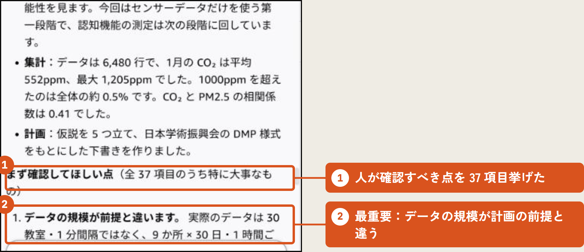

<!--
【ノート】50秒。
フローの最後のステップでは、人が確認すべき点が 37 項目並びました。
最も重要な点として挙がっていたのが、データの規模が計画の前提と違う、ということです。実際のデータは 30 教室の 1 分間隔ではなく、9 か所、30 日、1 時間ごとで、しかも 3 か所は教室ではなく図書館だ、と書かれていました。
ほかにも、文献レビューの引用の誤りの可能性、基準値の食い違い、1000ppm を超えたデータがわずかしかないこと、などが挙がっています。
さらに、計画のステップが手順書と CSV を読めていないので、フローのその部分を直して再実行しましょう、という改善の提案までありました。
一巡してみて分かったことをまとめます。
-->

---

<!-- _class: t4 dense -->

04

分かったこと

## 一巡して分かったこと

AI は研究プロセスを速く一巡させ、自らの誤りの候補も挙げるが、<em>前提の誤りを正すのは人</em>である。

| 観点 | 分かったこと | 人がすべきこと |
|---|---|---|
| 速さ | テーマ 1 つから、5 フェーズの成果物が 3 分 30 秒で出そろった | 出てきた候補から選ぶ |
| 計算 | コードで計算した集計値は、手元の検算とすべて一致した | 何をどう集計するかを確かめる |
| 自己点検 | 確認すべき点を 37 項目挙げ、フローの改善も提案した | 指摘を読んで判断する |
| 前提 | 計画のステップがデータを読めず、前提が実データと食い違った | 前提を実データと照らして正す |
| 資料の検証 | 研究室の資料の引用のうち、確認できないものを指摘した | 原典を確認する |

<!--
【ノート】55秒。
一巡して分かったことを 5 つの観点でまとめました。
速さ。テーマを 1 つ入れるだけで、5 つのフェーズの成果物が 3 分半で出そろいました。人は、その中から選べばよくなります。
計算。コードで計算した集計値は正確でした。人が確かめるのは、何をどう集計するかです。
自己点検。AI は自分の誤りの候補を 37 項目挙げてきました。人はそれを読んで判断します。
前提。ここが最も重要です。計画のステップがデータを読めず、前提がずれていました。前提を実データと照らして正すのは、人の仕事です。
資料の検証。研究室の資料の引用を疑ってくれましたが、最終的に原典を確かめるのは人です。
同じ作り方で、ほかにどんなことができるでしょうか。
-->

---

<!-- _class: t4 dense -->

04

応用

## 他の付帯業務への応用

Space に入れる資料と依頼文を変えれば、<em>同じ作り方</em>で他の付帯業務にも使える。

| 付帯業務 | Space に入れる資料 | AI に任せる作業 | 人が判断すること |
|---|---|---|---|
| 研究費の申請 | 公募要領・学内の規程・過去の申請書 | 要件との照合と、記載漏れの指摘 | 研究の構想と申請内容 |
| データ管理計画 | 日本学術振興会の様式・機関のデータポリシー | 様式に沿った下書き | 公開範囲と保存期間 |
| 研究室の引き継ぎ | 手順書・実験ノート・過去の議事録 | 新しいメンバーの質問への回答 | 手順の改訂 |
| 研究協力者への報告 | 分析結果・用語の言い換え集 | 読み手に合わせた説明文の作成 | 伝える内容と表現 |

発表者の案。研究計画調書を生成 AI に入力することは、審査の場面では禁じられている

<!--
【ノート】55秒。
今回の作り方は、研究テーマを入れて一巡させる、というものでしたが、Space に入れる資料と依頼文を変えれば、ほかの付帯業務にも使えます。ここからは私の案です。
研究費の申請なら、公募要領と学内の規程、過去の申請書を入れて、要件を満たしているか、記載漏れがないかを点検させる。データ管理計画なら、様式と機関のデータポリシーを入れて下書きさせる。研究室の引き継ぎなら、手順書や実験ノートを入れて、新しいメンバーの質問に答えさせる。研究に協力してくれた学校や自治体への報告なら、分析結果から分かりやすい説明文を作らせる。
いずれも、判断は人に残したまま、作業を AI に任せる形です。なお、審査する側が研究計画調書を生成 AI に入れることは禁じられているので、使う場面には注意が必要です。
実践をまとめます。
-->

---

<!-- _class: t4 -->

04

実践

AI が研究プロセスを数分で一巡させ、 人は前提を確かめて判断する。

| フェーズ | AI が行ったこと | 人が判断すること |
|---|---|---|
| 課題設定・文献調査 | 候補を採点し、資料の引用を検証した | 課題の選択と、引用の正しさ |
| 研究計画 | 計画と DMP を下書きし、未確定の箇所に印を付けた | 前提の正しさと、印を付けた箇所 |
| データ分析・成果発信 | コードで集計し、読み手ごとに書き分けた | 集計の前提と、主張の強さ |

<!--
【ノート】35秒。
実践のまとめです。AI が研究プロセスを数分で一巡させ、人は前提を確かめて判断する。
AI は候補を採点し、下書きを作り、集計し、書き分けました。人がすべきなのは、選ぶこと、前提を確かめること、そして主張が強すぎないかを見ることでした。
では、実際に大学や研究室で導入するとき、何を判断すればよいでしょうか。最後のトラックです。
-->

---

<!-- _class: t5 dark eye -->

05

### Adoption

導入の判断材料

<!--
【ノート】10秒。
最後のトラックでは、導入するときに確かめるべきこととして、データの扱い、料金、学内のデータとの接続、自前で作る選択肢を順に見ていきます。
-->

---

<!-- _class: t5 dense -->

05

データの扱い

## データの扱い

入力したデータは<em>基盤モデルの学習に使われず</em>、保存時と通信時は暗号化される。組織向けは IAM Identity Center で認証する。

| 観点 | AWS の説明 |
|---|---|
| 学習への利用 | 無料でも有料でも、顧客のデータを基盤モデルの学習に使わない |
| 暗号化 | 保存時は既定で暗号化し、通信は TLS 1.2 以上。自分の鍵での暗号化は Enterprise で使える |
| 認証 | Free と Plus はメールアドレスなど。組織向けは IAM Identity Center か IAM フェデレーション |
| 保存場所 | データは主リージョンにだけ保存する。東京リージョンでもエージェントの機能が使える |
| 安全策 | Amazon Bedrock Guardrails と Quick の安全策で、入力を確認する |

出典：<a href="https://docs.aws.amazon.com/quick/latest/userguide/sec-data-protection.html">Data protection</a>・<a href="https://docs.aws.amazon.com/quick/latest/userguide/regions.html">Regions</a>・<a href="https://aws.amazon.com/quick/faqs/">FAQ</a>｜AWS Quick

<!--
【ノート】55秒。
研究データや未発表の成果を扱ううえで、まず確かめたいのはデータの扱いです。
AWS は、無料のプランでも有料のプランでも、顧客のデータを基盤モデルの学習には使わないと明記しています。保存するデータは既定で暗号化され、通信も TLS 1.2 以上で暗号化されます。大学が自分で管理する鍵で暗号化したい場合は、Enterprise プランが必要です。
認証は、今回使った Free や Plus はメールアドレスなどで登録します。組織向けのプランでは、大学の ID 基盤とつなげられる IAM Identity Center などを使います。
データは主リージョンにだけ保存され、東京リージョンでもエージェントの機能が使えます。
科研費の公募要領が挙げていた情報漏えいのリスクを考えると、未発表のデータを入れるなら、組織向けのプランで学内の管理下に置くのが望ましいと考えます。次は料金です。
-->

---

<!-- _class: t5 dense -->

05

料金

## プランと料金

個人向けは 1 人あたり月 20 USD から使える。学内のデータに接続する組織向けは、<em>アカウントごとに月 250 USD</em> の基盤の料金が加わる。

| プラン | 料金 | 始め方 | AWS のデータとの接続 |
|---|---|---|---|
| Free | 0 USD | メールアドレスなど | なし |
| Plus | 1 人あたり月 20 USD。年払いの場合 | メールアドレスなど | なし |
| Professional | 1 人あたり月 20 USD と、月 250 USD | AWS のコンソール | あり |
| Enterprise | 1 人あたり月 40 USD と、月 250 USD | AWS のコンソール | あり |

2026-11-17 時点。他に Max と Essentials のプランがある。Plus の新しいアカウントは 30 日間無料、Enterprise は 25 人まで 30 日間のトライアルがある

出典：<a href="https://aws.amazon.com/quick/pricing/">AWS Quick の料金</a>

<!--
【ノート】50秒。
料金は 2 系統です。上の 2 つ、Free と Plus は個人やチーム向けで、メールアドレスで登録でき、AWS アカウントは要りません。Plus は年払いで 1 人あたり月 20 ドルです。
下の 2 つは、AWS のコンソールから契約する組織向けです。AWS に置いたデータにつなげますが、1 人あたりの料金に加えて、アカウントごとに月 250 ドルの基盤の料金がかかります。
研究室で試すなら、まず Plus の無料トライアルで十分です。学内のデータとつなぎたくなった段階で、組織向けを検討するのがよいと思います。
その学内のデータとの接続の仕組みを見てみます。
-->

---

<!-- _class: t5 dense -->

05

学内データとの接続

## 学内データとの接続

組織向けのプランでは、<em>自分の AWS アカウントに置いたデータ</em>に接続し、Quick Sight で可視化できる。

出典：<a href="https://docs.aws.amazon.com/quick/latest/userguide/supported-data-sources.html">Supported data sources｜AWS Quick ユーザーガイド</a>

<!--
【ノート】55秒。
AWS Quick の中の構成と、AWS のデータとの関係を図にしました。
左側が Quick の中です。Space の資料を、チャットエージェント、Research、Flows の 3 つの機能が、検索や Web 検索、コード実行の道具を使って処理します。S3 や Google Drive などの資料をナレッジベースとして取り込んだり、MCP や OpenAPI という形式で外部の API を呼んだりすることもできます。
右側は、組織向けのプランで接続できる、自分の AWS アカウントのデータです。研究データを S3 に置き、Glue で表の定義を作り、Athena で SQL を使って集計する、といった構成で、Quick Sight から直接可視化できます。
今回の実践は無料の Plus なので、右側にはつないでいません。AWS 公式のハンズオンには、この右側を自動で作るテンプレートがありますが、注意点があります。
-->

---

<!-- _class: t5 dense -->

05

学内データとの接続

## 公式テンプレートの注意点

AWS 公式のテンプレートは、Quick の <em>Enterprise の契約</em>とアカウント全体の設定変更まで自動で行う。

quicksight.create_account_subscription(
  Edition='ENTERPRISE',
  AuthenticationMethod='IAM_ONLY', ...)①
quicksight.update_spice_capacity_configuration(
  PurchaseMode='AUTO_PURCHASE')②
lf.put_data_lake_settings(DataLakeSettings={
  'DataLakeAdmins': current_admins, ...})③

①<b>Quick の契約</b>　Enterprise で契約する。スタックを削除しても契約は残る

②<b>容量の自動購入</b>　Quick Sight のデータの保存領域を自動で買い足す

③<b>Lake Formation</b>　自分のロールを、アカウント全体のデータレイクの管理者に加える

コードは公式テンプレートの Lambda から抜粋し、一部を省略した。発表者は作業後に契約を解約し、設定を元に戻した

<!--
【ノート】55秒。
AWS の公式ハンズオンには、CloudFormation のテンプレート 1 つで、S3、Glue、Athena と Quick の契約までを作る手順があります。便利ですが、テンプレートの中の Lambda のコードを読むと、注意すべき点が 3 つありました。
① Quick を Enterprise で契約します。CloudFormation のスタックを消しても、契約は残ります。
② データの保存領域を、足りなければ自動で買い足す設定にします。
③ アカウント全体のデータレイクの管理者に、自分のロールを加えます。
大学の共用の AWS アカウントで試すと、ほかの利用者にも影響する設定です。試すなら、作業前の状態を記録し、終わったら元に戻すことをおすすめします。私も実際に、作業後に解約して設定を戻しました。
最後に、Quick を使わずに自分たちで作る選択肢と比べます。
-->

---

<!-- _class: t5 dense -->

05

自前の選択肢

## 自前で作る選択肢

すぐ使うなら AWS Quick、学内の仕組みに深く組み込むなら <em>Bedrock と AgentCore</em> で作る。その中間に GenU がある。

| 観点 | AWS Quick | Bedrock と AgentCore で作る | GenU を使う |
|---|---|---|---|
| 位置付け | すぐ使える AI エージェント | エージェントを作って動かす基盤 | AWS ジャパンの有志が公開する OSS |
| 作る手間 | 不要。ブラウザで使う | 開発が必要 | デプロイして設定する |
| 自由度 | 機能の範囲内 | 画面も処理も自由に作れる | 中程度。改修できる |
| 教育機関の例 | 今回の実践 | ― | 東北大学が全教職員に提供 |

東北大学は GenU を改修し、検討から 1 か月で内製した。議事録の作成時間は 4 分の 1、運用費は従来の 3 分の 1 になったと報告されている

出典：<a href="https://docs.aws.amazon.com/bedrock-agentcore/latest/devguide/what-is-bedrock-agentcore.html">Amazon Bedrock AgentCore</a>・<a href="https://github.com/aws-samples/generative-ai-use-cases">GenU｜aws-samples</a>・<a href="https://aws.amazon.com/jp/blogs/news/aws-jpps-seminar-2026-april/">AWS 公共セミナー 2026 開催報告</a>

<!--
【ノート】55秒。
Quick を使わない選択肢もあります。
Amazon Bedrock と AgentCore を使えば、モデルも画面も処理も自由にエージェントを作れます。そのぶん開発が必要です。
その中間にあるのが、AWS ジャパンの有志が公開している OSS の GenU です。生成 AI のよくある使い方をまとめたアプリで、デプロイして設定すれば使え、改修もできます。東北大学は GenU を改修して全教職員に提供し、検討から 1 か月で内製、議事録の作成時間が 4 分の 1、運用費が従来の 3 分の 1 になったと報告されています。
研究室で今日から試すなら Quick、大学全体の仕組みとして深く組み込むなら自前、という使い分けになると考えます。
では、導入をどう進めるかです。
-->

---

<!-- _class: t5 dense -->

05

導入の進め方

## 導入の進め方

導入は、研究室で<em>試す</em>、学内のデータに<em>接続する</em>、確認の手順を<em>定着させる</em>、の 3 段階で進める。

1<b>試す</b>研究室の公開済みの資料を Space に入れ、Plus の無料トライアルで研究プロセスを一巡させる

2<b>接続する</b>未発表のデータや学内の ID 基盤に接続する段階で、組織向けのプランと月 250 USD の基盤の料金を検討する

3<b>定着させる</b>検算・原典の確認・前提の確認を、研究室の手順書に書き込み、誰が確かめるかを決める

発表者の案。研究推進の部署や URA、図書館が、最初の試行と手順書づくりを支援する形も考えられる

<!--
【ノート】55秒。
導入は 3 つの段階で進めるのがよいと考えます。
1 つ目は試す。まずは公開済みの論文や手順書のような、外に出ても困らない資料を Space に入れて、無料トライアルで研究プロセスを一巡させてみます。費用はかかりません。
2 つ目は接続する。未発表のデータや、大学の ID 基盤とつなぎたくなったら、組織向けのプランと月 250 ドルの基盤の料金を検討します。
3 つ目は定着させる。今日見たように、AI は前提を取り違えますし、引用も確かめる必要があります。検算、原典の確認、前提の確認を、研究室の手順書に書き込み、誰が確かめるかを決めておきます。
研究推進の部署や URA、図書館が、最初の試行や手順書づくりを支援する形も考えられます。
最後に、全体をまとめます。
-->

---

<!-- _class: t5 -->

05

まとめ

研究時間の量は増やしにくい。 付帯業務を AI に任せ、 研究者は問いと判断に集中する。

| トラック | 要点 |
|---|---|
| 研究時間の現状と国の方針 | 研究時間は教育と診療に移り、付帯業務は制度で増えた。国は研究プロセスの自動化を目指す |
| 研究プロセスと AI の分担 | AI には調査・整理・下書き・計算を任せ、人は選択・解釈・責任を担う |
| AWS Quick | Space・エージェント・Research・Flows で、必要な 4 つの能力がそろう |
| 実践 | 5 フェーズを 3 分 30 秒で一巡。前提の誤りは人が正した |

<!--
【ノート】45秒。
今日のまとめです。研究時間の量は増やしにくい。だから、研究時間の中の付帯業務を AI に任せ、研究者は問いと判断に集中する。
研究時間は教育と診療に移り、研究時間の中の付帯業務は制度で増えています。国も研究プロセスの自動化を目指しています。
研究プロセスの各フェーズで、AI には調査、整理、下書き、計算を任せ、人は選択、解釈、責任を担う。AWS Quick なら、そのための 4 つの能力がそろいます。実際に 5 つのフェーズを 3 分半で一巡させることができ、前提の誤りは人が見つけて正しました。
最後に、最初の一歩をご提案します。
-->

---

<!-- _class: cover -->
<!-- _header: '' -->
<!-- _paginate: false -->

# 研究室の資料を 1 つの Space に

まずは公開済みの資料で、研究プロセスを一巡させてみてください

<!--
【ノート】20秒。
最初の一歩は、研究室の公開済みの資料を 1 つの Space にまとめることです。無料のトライアルなら、カードの登録も要りません。皆さんの研究室や、支援している大学で、ぜひ一度、研究プロセスを一巡させてみてください。ありがとうございました。
-->

---

<!-- _class: t5 dense appendix -->

05

付録

## 付録：実行の記録

発表では使いません。質疑や後から読まれるときの手元資料です。実践で AI に渡した入力と、実行した環境をまとめます。

| 項目 | 内容 |
|---|---|
| 実施日と環境 | 2026 年 11 月 17 日。AWS Quick の Plus の無料トライアルで、クレジットカードは登録していません |
| 使った資料 | AWS 公式の研究者向けハンズオンのサンプル 5 点。EPA_AQI_Guide.pdf、ASHRAE_62.1_Summary.pdf、iaq_literature_review.docx、sensor_deployment_protocol.md、classroom_sensors_2025.csv |
| フローの依頼文 | 研究テーマを入れると、問う・調べる・計画する・確かめる・伝えるで一巡し、計画では日本学術振興会の DMP の項目に沿った下書きを作り、最後に人が確認すべき点を並べる |
| 実行 | テーマは「教室の CO₂ 濃度と学生の認知機能」。1 回目は 3 分 7 秒でデータ分析のステップが失敗し、Quick の修正後、2 回目は 3 分 30 秒で完了しました |
| 機能の確認 | チャットエージェント・Research・コード実行・費用見積もりのフローを、同じ日に試しました |
| 検算 | 集計の値は、発表者が Python で同じ CSV を集計して確かめました |

<b>注</b>　AI の出力は実行のたびに変わります。数値や表現は、記録した日の 1 回の結果です。

<!--
【ノート】付録。発表では使わない。質疑で聞かれたときの手元資料。
-->

---

<!-- _class: t5 dense appendix -->

05

付録

## 付録：参考にした公式ハンズオン

発表では使いません。実践の資料は、AWS 公式のハンズオンのサンプルを使いました。公式の手順との違いと、AWS アカウントの後片付けをまとめます。

| 項目 | 内容 |
|---|---|
| ハンズオン | Amazon Quick for Research。大学の研究アシスタントと研究スタッフ向けで、所要時間は約 2.5 時間です |
| 公式の手順との違い | 公式の手順は Enterprise の契約を前提にしています。今回は Plus の無料トライアルで行い、Quick Sight のダッシュボードと OpenAPI のアクションの演習は省きました。研究プロセスを一巡させるフローは、発表者が独自に作りました |
| Enterprise の契約 | 公式の CloudFormation が Enterprise を自動で契約しました。トライアルかどうかを画面で確かめられなかったため、作成から 1 時間以内に CLI で解約しました |
| AWS の後片付け | スタックの削除、S3 を空にする、Lake Formation の管理者を元に戻す、Quick のサービスロールと Lambda のログの削除を行い、作業前と同じ状態に戻したことを CLI で確かめました |

出典：<a href="https://catalog.us-east-1.prod.workshops.aws/workshops/ca04310e-b365-49f4-830b-a02bb06658e9/en-US">Amazon Quick for Research｜AWS Workshop Studio</a>

<!--
【ノート】付録。発表では使わない。質疑で聞かれたときの手元資料。
-->

---

<!-- _class: t5 dense appendix -->

05

付録

## 付録：出典

本編で使った数値と仕様の出典です。

| 内容 | 出典 |
|---|---|
| 研究時間と申請・報告の時間 | <a href="https://www.mext.go.jp/content/20250418-mxt_chousei01-000040124.pdf">文部科学省 令和5年度 大学等におけるフルタイム換算データに関する調査 概要</a> |
| データマネジメントプラン | <a href="https://www8.cao.go.jp/cstp/kihonkeikaku/6honbun.pdf">第6期科学技術・イノベーション基本計画</a>・<a href="https://www.jsps.go.jp/j-grantsinaid/01_seido/10_datamanagement/index.html">日本学術振興会 科研費の研究データの管理</a> |
| 即時オープンアクセス | <a href="https://www8.cao.go.jp/cstp/oa_240216.pdf">学術論文等の即時オープンアクセスの実現に向けた基本方針</a> |
| AI for Science | <a href="https://www.mext.go.jp/content/20260403-mxt_jyohoka01-000048752_1.pdf">AI for Science の推進に向けた基本的な戦略方針</a>・<a href="https://www.mext.go.jp/content/20260629-mxt_jyohoka01-000050750_1.pdf">推進委員会 第5回 資料1</a> |
| 生成 AI と科研費 | <a href="https://www.jsps.go.jp/file/storage/kaken_kiban_2026_g_4978/r9_7_kobo.pdf">令和9年度 科研費 公募要領</a>・<a href="https://www.mext.go.jp/content/20260602-mxt_gakjokik-000050033_1.pdf">研究費部会 資料</a> |
| AWS Quick | <a href="https://docs.aws.amazon.com/quick/latest/userguide/what-is.html">ユーザーガイド</a>・<a href="https://aws.amazon.com/quick/pricing/">料金</a>・<a href="https://aws.amazon.com/quick/faqs/">FAQ</a>・<a href="https://aws.amazon.com/about-aws/whats-new/2026/11/amazon-quick-aws-quick/">改称の発表</a> |
| AWS の生成 AI | <a href="https://docs.aws.amazon.com/decision-guides/latest/decision-guides/genai-guide.html">AWS Decision Guide</a>・<a href="https://aws.amazon.com/jp/blogs/news/aws-jpps-seminar-2026-april/">AWS 公共セミナー 2026 開催報告</a> |

<b>注</b>　制度の解釈は発表者が調べて整理したものです。実際に使うときは原典と専門家に確かめてください。

<!--
【ノート】付録。発表では使わない。質疑で聞かれたときの手元資料。
-->
